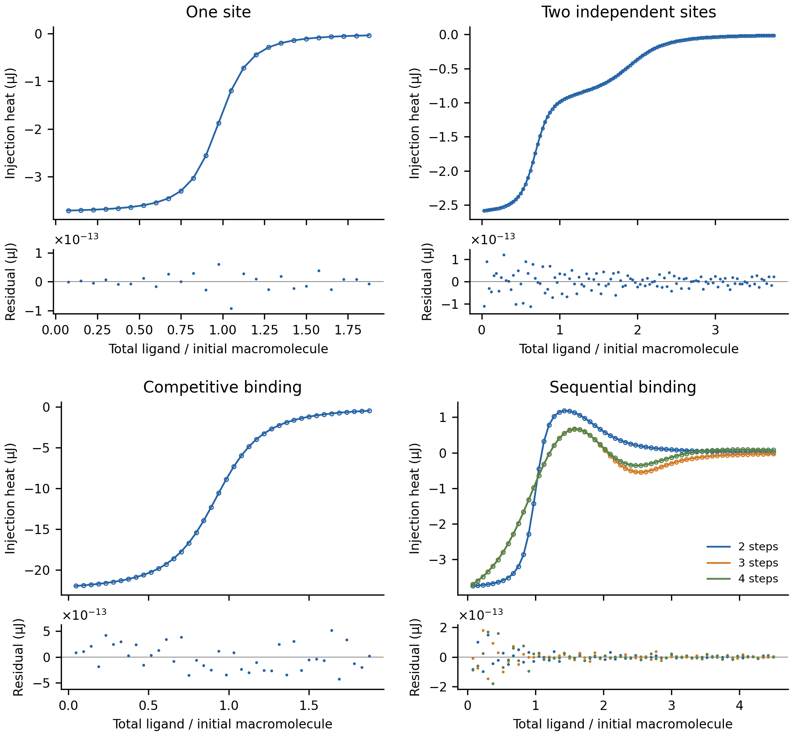

# Forward-model precision validation

All 52 tests **PASS** at floating-point precision using prescribed parameters and externally generated integrated injection heats.

The covered domain is one-site, independent two-site, competitive and sequential
models under **Discrete displacement** bookkeeping. These references do not
validate MicroCal or ideal continuous mixing bookkeeping, Dissociation, or
tandem back-mixing. Processing accuracy, parameter recovery and uncertainty
coverage require their own evidence.

References use pinned pytc equations and finite injections. Both default and converged arithmetic were evaluated. The PASS criterion is `|errorᵢ| ≤ 512ε (peak |heat| + |reference heatᵢ|)`, with `ε = 2.220446049250313e−16`.

Converged references use `xtol = 2e−24 M` for binding polynomials and 80-digit arithmetic for the competitive analytical expression. A further check at `2e−27 M` and 100 digits confirms convergence. FT-ITC uses its production forward models, without fitting.

Lines: pytc. Circles: FT-ITC. Sequential curves show two, three and four steps. Residuals are FT-ITC minus pytc injection heats. Full parameters: [results.csv](results.csv). Numerical comparisons, including the default-reference audit: [comparisons.json](comparisons.json).

| Test | Model | N | Floating-point precision |
| --- | --- | --- | --- |
| one-exothermic | one-site | 1.1 | PASS |
| one-endothermic | one-site | 1.1 | PASS |
| one-c10-small | one-site | 1 | PASS |
| one-c100-small | one-site | 1 | PASS |
| one-c1000-small | one-site | 1 | PASS |
| one-c10-large | one-site | 1 | PASS |
| one-c100-large | one-site | 1 | PASS |
| one-c1000-large | one-site | 1 | PASS |
| one-n05 | one-site | 0.5 | PASS |
| one-n1 | one-site | 1 | PASS |
| one-n2 | one-site | 2 | PASS |
| two-c50-r10 | two-site | 1, 1 | PASS |
| two-c500-r10 | two-site | 1, 1 | PASS |
| two-c2000-r10 | two-site | 1, 1 | PASS |
| two-c50-r100 | two-site | 1, 1 | PASS |
| two-c500-r100 | two-site | 1, 1 | PASS |
| two-c2000-r100 | two-site | 1, 1 | PASS |
| two-realistic | two-site | 1, 1 | PASS |
| two-realistic-500pM | two-site | 1, 1 | PASS |
| two-realistic-5nM | two-site | 1, 1 | PASS |
| two-tight-scale-2x | two-site | 1, 1 | PASS |
| two-tight-scale-10x | two-site | 1, 1 | PASS |
| two-tight-scale-100x | two-site | 1, 1 | PASS |
| two-kd50-50 | two-site | 1, 1 | PASS |
| two-kd50-500 | two-site | 1, 1 | PASS |
| two-kd50-5000 | two-site | 1, 1 | PASS |
| two-kd500-500 | two-site | 1, 1 | PASS |
| two-kd500-5000 | two-site | 1, 1 | PASS |
| two-kd500-50000 | two-site | 1, 1 | PASS |
| competitive-0 | competitive | 1 | PASS |
| competitive-500 | competitive | 1 | PASS |
| competitive-1000 | competitive | 1 | PASS |
| sequential-2 | sequential | — | PASS |
| sequential-2-low-affinity | sequential | — | PASS |
| sequential-3 | sequential | — | PASS |
| sequential-3-low-affinity | sequential | — | PASS |
| sequential-4 | sequential | — | PASS |
| sequential-4-low-affinity | sequential | — | PASS |
| fractional-low-capacity | two-site | 0.7, 1.4 | PASS |
| fractional-high-capacity | two-site | 1.2, 1.8 | PASS |
| unequal-integer-capacity | two-site | 2, 3 | PASS |
| small-fractional-capacity | two-site | 0.45, 0.3 | PASS |
| opposing-enthalpies | two-site | 0.9, 1.35 | PASS |
| both-endothermic | two-site | 1.6, 0.8 | PASS |
| similar-affinities | two-site | 0.55, 1.1 | PASS |
| equal-affinities-cancellation | two-site | 0.7, 1.4 | PASS |
| tight-minority-site | two-site | 0.35, 0.7 | PASS |
| weak-binding | two-site | 1.3, 0.65 | PASS |
| variable-shots | two-site | 1.2, 1.8 | PASS |
| preloaded-ligand | two-site | 0.7, 1.4 | PASS |
| large-cell | two-site | 1.6, 0.8 | PASS |
| reversed-site-order | two-site | 1.8, 1.2 | PASS |
