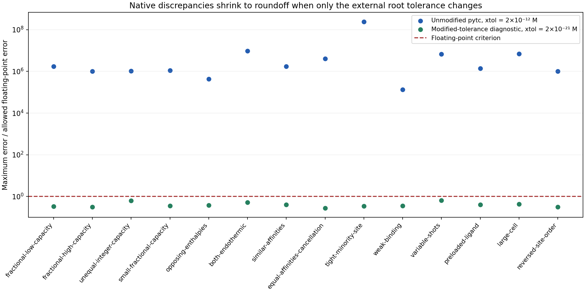
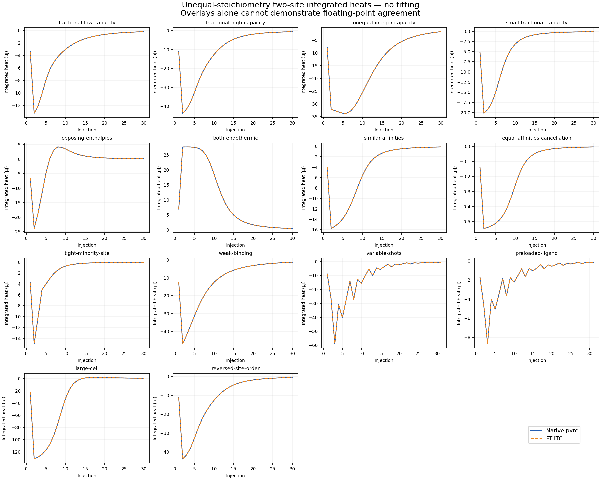

Historical default-tolerance record; superseded by ../ForwardPrecision/README.md.

# Unequal-stoichiometry two-site forward comparisons

Run date: 11 October 2026

**Unmodified native pytc: 0/14 meet floating-point agreement.** Maximum error is 0.00345042% of peak integrated heat. All 14 are below the older 0.01% practical threshold; that threshold is not used to call these validation successes.

**Separate modified-tolerance diagnostic: 14/14 meet the same floating-point criterion at xtol = 2e-21 M.** At 2e-18 M, 6/14 meet it. Only the external C root solver's absolute tolerance changes. These results support agreement of the implemented mathematics, but do not turn the unmodified-pytc failures into passes.



## Parameters and outcomes

N values are unequal in every case, and neither equals 1. Fractional N represents effective site capacity per nominal macromolecule. Values are selected for low, moderate and tight binding, with sufficient syringe ligand to traverse the capacities. Parameters are declared inputs; no solver estimates them. Concentrations and Kd are in µM; enthalpies are in kJ/mol.

| Case | N₁, N₂ | Cell / syringe (µM) | Kd₁, Kd₂ (µM) | ΔH₁, ΔH₂ (kJ/mol) | Native max error (% peak) | Tight diagnostic max error / peak |
|---|---|---|---|---|---|---|
| fractional-low-capacity | 0.7, 1.4 | 12 / 260 | 0.35, 8.5 | -28.5, -15.7 | 3.76125e-05 | 7.66e-14 |
| fractional-high-capacity | 1.2, 1.8 | 24 / 700 | 0.8, 14 | -34, -19 | 2.28781e-05 | 6.32e-14 |
| unequal-integer-capacity | 2, 3 | 16 / 680 | 1.3, 18 | -22.5, -41 | 2.35758e-05 | 1.27e-13 |
| small-fractional-capacity | 0.45, 0.3 | 35 / 350 | 0.55, 6.7 | -31.2, -16.4 | 2.40352e-05 | 7.18e-14 |
| opposing-enthalpies | 0.9, 1.35 | 18 / 480 | 0.6, 5.2 | -37, 18.5 | 6.25308e-06 | 6.45e-14 |
| both-endothermic | 1.6, 0.8 | 28 / 650 | 1.1, 9.3 | 21, 33.5 | 0.000136702 | 1.09e-13 |
| similar-affinities | 0.55, 1.1 | 21 / 420 | 2.4, 2.7 | -26.3, -17.3 | 2.5516e-05 | 6.42e-14 |
| equal-affinities-cancellation | 0.7, 1.4 | 19 / 430 | 1.7, 1.7 | -30, 14 | 8.15837e-05 | 4.46e-14 |
| tight-minority-site | 0.35, 0.7 | 9 / 180 | 0.0025, 1.8 | -42, -20.5 | 0.00345042 | 7.87e-14 |
| weak-binding | 1.3, 0.65 | 45 / 1600 | 22, 95 | -19.5, -33 | 2.20989e-06 | 5.07e-14 |
| variable-shots | 1.2, 1.8 | 24 / 700 | 0.8, 14 | -34, -19 | 0.000110535 | 1.07e-13 |
| preloaded-ligand | 0.7, 1.4 | 12 / 260 | 0.35, 8.5 | -28.5, -15.7 | 2.42617e-05 | 6.38e-14 |
| large-cell | 1.6, 0.8 | 17 / 400 | 0.7, 11 | -29.8, 12.3 | 0.000159314 | 9.72e-14 |
| reversed-site-order | 1.8, 1.2 | 24 / 700 | 14, 0.8 | -19, -34 | 2.28781e-05 | 6.32e-14 |

The usual protocol is a 200 µL cell, one 0.5 µL shot and 29 × 2 µL shots. Variable and preloaded cases use one 0.4 µL shot followed by six repeats of [1.2, 2.8, 1.6, 2.4, 2.0] µL. The preloaded case starts with 9 µM total ligand. The large-cell case uses 1400 µL, one 2 µL shot and 29 × 12 µL shots. Background heat is zero.

The grid covers unequal fractional/integer capacities, both positive and negative enthalpies, opposing contributions, near cancellation, similar/equal affinities, a tight minority site, weak binding, variable shots, preloaded ligand, cell-volume scaling and reversed site order. It does not validate parameter recovery, tandem back-mixing or other dilution/heat conventions.



## Exact external mapping and provenance

For N₁ = f·a and N₂ = f·b, where a and b are small integers, the native polynomial is P(L) = (1 + K₁L)^a (1 + K₂L)^b with fx_competent = f. Each coefficient βⱼ is the sum of affinity products over all j-occupied microscopic states; dHⱼ is their affinity-weighted enthalpy. This yields the same shared-ligand balance and heat content as two independent site classes. It is not a sum of separately titrated one-site curves. The C# tests verify polynomial, bound-ligand and enthalpy identities against closed-form independent-site expressions.

[Pinned pytc source](https://github.com/harmslab/pytc/tree/d9ccde3f04e35a3d821ff37a4ad42e62a048d4ac) performs all concentration updates, equilibria and finite-injection heats through BindingPolynomial.dQ → bp_ext.dQ. Locally authored code only maps inputs and serializes native arrays. Python 3.9.6, numpy 1.26.4, scipy 1.13.1 and pytc-fitter 1.1.5 were used; compatible build tools were setuptools 75.8.2 and wheel 0.45.1.

The native manifest records generator, source, binary and .DH hashes. A second native generation reproduced the full manifest and all 14 .DH files byte-for-byte. comparisons.json retains every original native and actual production-model heat. convergence-diagnostic.json separately records the two tolerance patches, compiled binary hashes and all 28 modified-tolerance arrays. Native fixture heats are never replaced.

## Reproduction

```sh
python generate_reference.py --pytc-source /absolute/pinned/pytc
python convergence_diagnostic.py --pytc-source /absolute/pinned/pytc
# From the repository root; use an absolute destination:
FTITC_RUN_TWO_SITE_ROUNDOFF=1 FTITC_TWO_SITE_RESULTS=/absolute/repo/AnalysisITC.Tests/ScientificValidation/TwoSiteStoichiometry dotnet test AnalysisITC.Core.Tests --filter FullyQualifiedName~TwoSiteStoichiometryForwardTests
python AnalysisITC.Tests/ScientificValidation/TwoSiteStoichiometry/report_results.py
```

The strict unmodified-pytc comparisons deliberately remain executable and fail when enabled. Ordinary runs skip those known mismatches, run all 14 mapping checks and all 14 tightened-tolerance checks, and separately verify/record the native outcomes. A green ordinary suite must not be presented as 14 unmodified-pytc forward-validation successes. Acceptance is abs(errorᵢ) ≤ 512·double_epsilon·(peak_abs_native_heat + abs(native_heatᵢ)); peak scaling keeps the criterion meaningful near zero heat.

## Recorded test execution

- Full Core: 2559 passed, 0 failed, 2 skipped.
- Focused with strict comparisons enabled: 63 passed, 14 failed, 0 skipped.

The 14 focused failures are the strict unmodified-pytc roundoff comparisons. The 63 focused passes include all 14 tightened-tolerance comparisons, all 14 exact mapping checks, native-outcome recording, and existing root/bookkeeping checks. Full Core skips the strict native comparison theory and the existing higher-step recovery diagnostic. verification.json records the TRX hashes and failed test names. No production model code changed.
