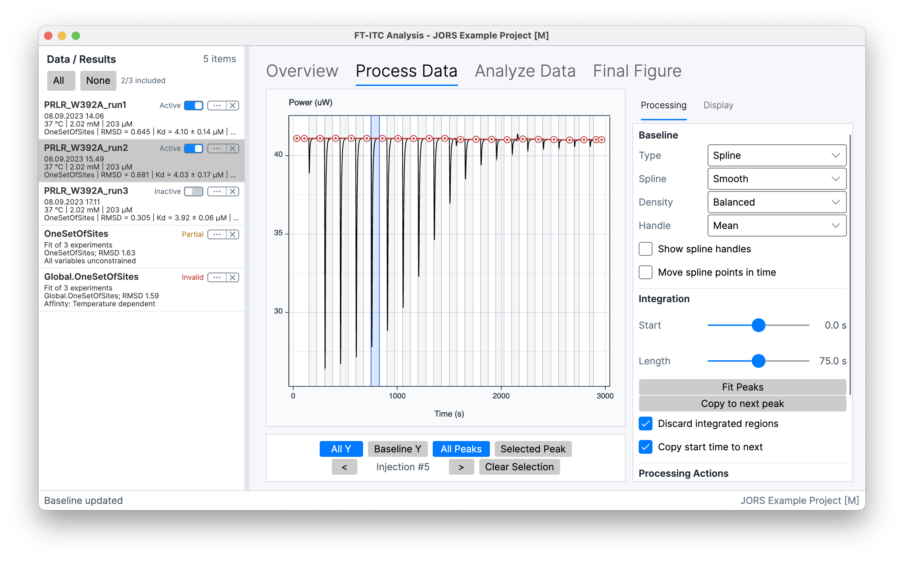
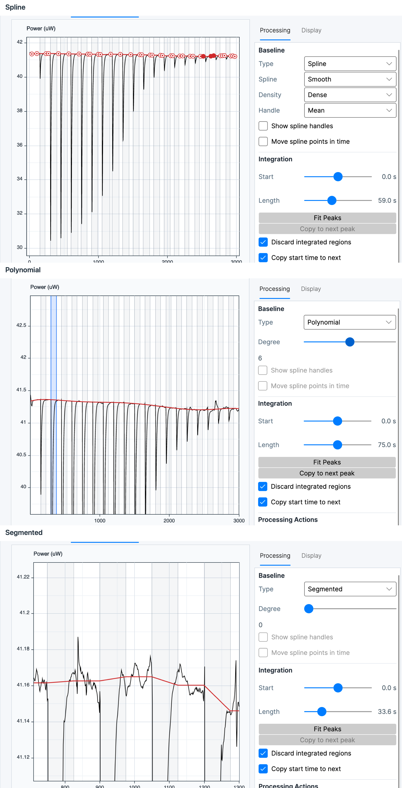
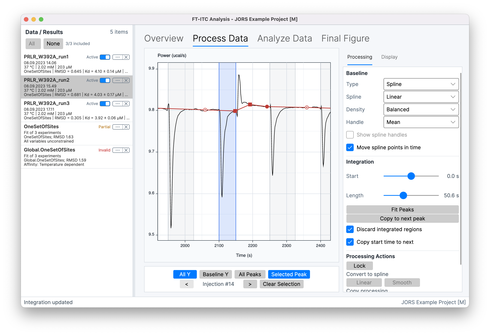

# Processing

Open **Process Data** for experiments with a raw thermogram. Choose a baseline, inspect every integration region, then lock processing when it is ready. Integrated-heat inputs skip this stage.

The baseline should follow the signal between injections, and each region should capture the response without unnecessary baseline noise. Use Polynomial or Segmented for suitable automatic baselines and Spline for manual control.

For optional experiment/sample IDs after import, see [Details and attributes](04-workspace-experiments.md#details-and-attributes) and [General preferences](11-preferences-troubleshooting.md#general).

## Processing workspace

*Process Data combines the thermogram with baseline, integration, display, and navigation controls.*

The **Processing** controls configure the baseline and integration regions. The **Display** controls show or hide the baseline, integration regions, corrected data, and cursor information.

With **All injections** selected, **Start** and **Length** apply to every injection. A selected graph region targets one injection, and double-clicking it focuses the graph on that peak. The previous and next controls move through the injections; **Clear Selection** returns to all injections.

The view controls separate horizontal and vertical scaling:

- **All Y** shows the complete power range, while **Baseline Y** emphasizes the baseline region.
- **All Peaks** shows the full injection series, while **Selected Peak** focuses on the current injection.
- Dragging an empty part of the graph zooms into the selected region.

## Baseline models and editing

*Spline, Polynomial, and Segmented provide different baseline representations for thermogram processing.*

### Spline

**Spline** places points in usable baseline regions and interpolates between them. It provides the most direct graphical control.

- **Linear** connects the spline points with straight sections. **Smooth** produces a continuously varying baseline and supports editable slope handles.
- **Sparse**, **Balanced**, and **Dense** change the number of automatically generated points.
- **Mean**, **Median**, and **Min volatility** determine the representative power used for an automatically generated point.
- **Show spline handles** displays the slope handles for a Smooth spline. **Move spline points in time** allows a point to be dragged horizontally as well as vertically.

Dragging a point corrects its position. A secondary-click on the graph adds a point **At Data** or **At Baseline**. A secondary-click on an existing point exposes **Lock** or **Unlock**, **Mark Linear** or **Unmark Linear**, and **Remove**. Marking neighboring points as linear makes the interval between them straight. Locked points are retained when automatic spline points are regenerated.

**Balanced** provides the middle spline-point density. Greater density increases local flexibility but can also follow noise or absorb part of an injection response.

### Polynomial

**Polynomial** fits one polynomial across the complete thermogram and is suited to smooth global drift. **Degree** controls flexibility, from 0 to 24; the default is 12.

A polynomial baseline is least constrained at the beginning and end of the run, where a high degree can produce large deviations. Increasing the degree adds flexibility, but the baseline may then follow noise or part of an injection response.

### Segmented

**Segmented** fits local constant, linear, or quadratic baseline behavior between integration regions and blends the local estimates across the run. It is suited to locally changing drift for which one global polynomial is too rigid. **Degree** selects the local behavior.

Local flexibility can follow genuine drift, but it also makes the result more dependent on the integration boundaries and on the baseline immediately around each peak.

### Exclude integration regions from the baseline

When **Discard integrated regions** is enabled, data inside the current integration regions are excluded when the baseline is recalculated. Moving a boundary can therefore change both the integrated area and the estimated baseline.

> **Caution:** Boundaries should follow the observed response and a consistent processing rule, not the heat expected from a model.

### Convert to a spline

A Polynomial or Segmented baseline can be converted to a **Smooth** or **Linear** Spline when the automatic baseline is a useful starting point for graphical editing. Conversion changes the baseline representation and creates editable spline points.

Conversion locks processing so that the converted points are kept. **Unlock** processing to edit the points. Moving, adding, removing, or individually unlocking a point retains the existing spline. Individual **Unlock** releases both the point position and slope locks; a Smooth spline recalculates the released slope from the current points. Changing spline settings or integration regions, or running **Fit Peaks**, regenerates all spline points from the data and discards the converted points.

#### Conversion details

A Polynomial baseline is sampled at evenly spaced points; the point density setting controls how many. A Segmented baseline instead receives a point at each end of every fitted segment and one midpoint in each integration region where the blend between neighboring segments curves. A Linear conversion also adds a midpoint inside each quadratic segment. A Smooth conversion gives every point a fixed slope taken from the segments, so the fitted segments are kept exactly and only the curve across the integration regions is approximated. The point density setting does not apply to Segmented conversion.

## Integration regions

*Selecting an injection exposes its individual boundaries and navigation controls.*

Each injection region has a start and an end boundary. **Start** sets the offset of the start boundary relative to the injection. Despite its label, **Length** sets the end boundary in seconds after the injection begins, rather than the duration measured from the selected start boundary. For example, **Start** = 2 s and **Length** = 20 s define an 18 s integration region.

Either boundary can be dragged in the graph or adjusted with the controls. The application constrains the start and end to a valid interval within the injection scope and preserves a minimum separation between them.

### Estimate end points with Fit Peaks

**Fit Peaks** estimates the end of each injection response from the baseline-corrected thermogram. When **Discard integrated regions** is enabled, it recalculates the baseline using the updated regions.

When the endpoints settle, or a repeating set of endpoints is resolved, the application reintegrates the heats using the final regions and corresponding baseline. If peak fitting fails or does not find a stable result, the previous regions are restored. Peak shapes can vary across the titration, so review the boundaries, especially for the first injection.

The experiment records that its end points came from **Fit Peaks**, and the analysis report states this. Moving an end boundary, using the length control, or **Copy to next peak** marks the regions as set manually. Copying processing to other experiments runs **Fit Peaks** on each of them.

### Copy a region to the next injection

Selecting an injection and choosing **Copy to next peak**, or pressing **Space**, copies its end boundary relative to the injection start and advances to the next injection. **Copy start time to next** includes the start boundary in that operation.

## Propagate and lock processing

**Active** under **Copy processing** copies the selected experiment's processing to the other included experiments. This can replace existing processing when a destination is unlocked. **New** targets experiments without a baseline, whether included or not. In native macOS, **All** targets all other experiments, whether included or not.

Experiments without a raw thermogram are skipped; the status message reports how many.

Locked destinations are not overwritten. Copying from a locked source recalculates each destination's baseline and heats, then locks it. Copying from an unlocked source leaves destinations unlocked; choose **Lock** to protect them. Locking disables baseline, spline-point, integration-region, and peak-fitting edits; **Unlock** makes changes available again.

## Integration calculation

> **Calculation:**
>
> $$
> q_{i,\mathrm{raw}} = \int [P(t) - b(t)]\,\mathrm{d}t
> $$
>
> $$
> \Delta H_i = \frac{q_i}{n_i}
> $$
>
> $$
> n_i = c_{\mathrm{syr}} V_i
> $$
>
> The integral is evaluated between the injection's integration boundaries. Each recorded power value represents the trailing-period average ending at its timestamp, so fractional intervals at either selected boundary are included using the appropriate right-endpoint sample. $P(t)$ is differential power, $b(t)$ is the estimated baseline, and $q_{i,\mathrm{raw}}$ is the raw integrated heat. The heat $q_{i}$ equals that raw value unless optional buffer subtraction changes it. $c_{\mathrm{syr}}$ is the syringe concentration, $V_{i}$ is the injection volume, $n_{i}$ is the injected amount, and $\Delta H_{i}$ is the molar heat.

## Injection uncertainty

Each injection error bar shows an estimated ±1 standard deviation for that injection's molar heat: roughly, how much the calculated heat might vary because of local noise in the thermogram. It is calculated independently for every injection, so the bars can vary across a titration. It does not cover every source of experimental error. These processing dependent estimates can be used for weighted fitting.

**Weight by injection error** can use these estimates in the fitting objective. Concentration uncertainty is handled separately in supported resampling calculations. Both behaviors are described under [Fitting calculation](06-fitting-models.md#fitting-calculation).

### Noise calculation and limits

The calculation uses baseline-corrected samples around the injection. It combines an estimate of local power noise with the temporal correlation between neighboring samples, the integration-region length, and uncertainty in the baseline level. A longer or noisier region will therefore often have a larger estimated uncertainty. When Buffer Subtraction is applied, the independent target and reference heat uncertainties are combined.

Let $\sigma_{p,i}$ be local RMS power noise and $T_{\mathrm{int}}$ the integration duration in seconds. The heat SD combines integration-noise and baseline-level contributions:

> **Calculation:**
>
> $$
> \sigma_{q,i} = \sqrt{\sigma_{q,i,\mathrm{int}}^2 + \sigma_{q,i,\mathrm{bl}}^2}
> $$
>
> $$
> \sigma_{q,i,\mathrm{int}} = \sigma_{p,i} \cdot \sqrt{\sum_{j,k} w_j w_k r^{\lvert j-k \rvert}}
> $$
>
> $$
> \sigma_{q,i,\mathrm{bl}} = \sigma_{p,i} \cdot \frac{T_{\mathrm{int}}}{\sqrt{N_{\mathrm{bl,eff}}}}
> $$
>
> $w_{j}$ is the time each sample contributes to the heat, in seconds; $r$ is the correlation between neighboring samples. $N_{\mathrm{bl},\mathrm{eff}}$ is the effective baseline-sample count accounting for correlated noise. Local noise is estimated from samples before integration and near the end of the injection interval; the latter can overlap integration. These are processing-derived heat SDs, not model-estimated parameter uncertainties.

For a molar-heat plot, the heat and its SD are both divided by the injected amount $n_{i}$ defined above.

The correlation estimate uses only consecutive baseline sample pairs separated by at most twice the sampling interval. Both its product sum and its normalization use those same pairs, excluding a pair across a longer integration gap. Propagation assumes an AR(1) noise model, in which correlation decays geometrically with sample separation; this is a chosen approximation to the local noise.

> **Note:** If an injection has no processing-derived uncertainty estimate, its stored error is zero and no error bar appears. Integrated-heat imports have no thermogram from which to calculate this estimate. A zero or absent error bar does not establish that the injection has no uncertainty.

The bars do not include uncertainty in cell or syringe concentration, fitted parameters, or model-derived confidence bands. They also do not quantify baseline-model choice, integration-boundary choice, calibration error, other instrumental effects, or other systematic uncertainty. Consequently, they do not validate the selected processing or constitute confidence intervals for the true heat.
