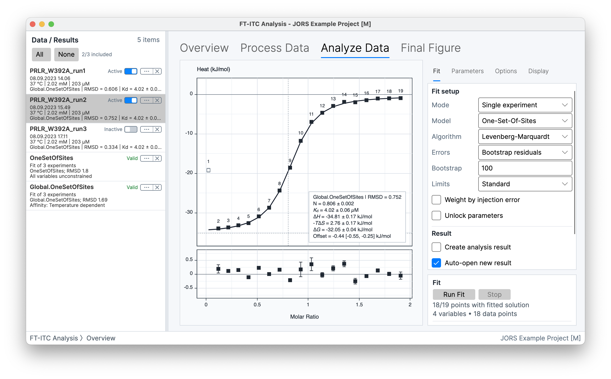
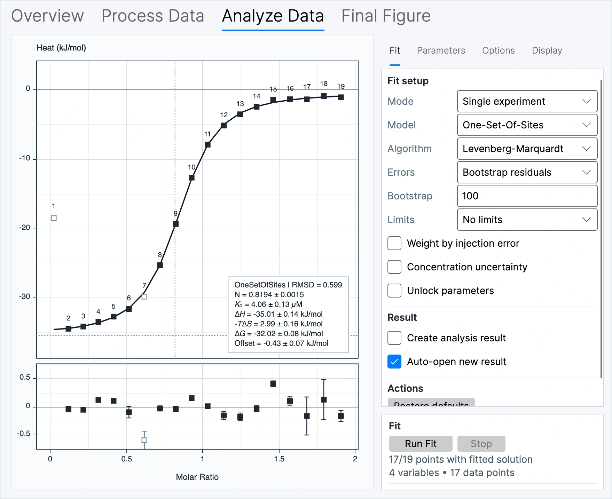
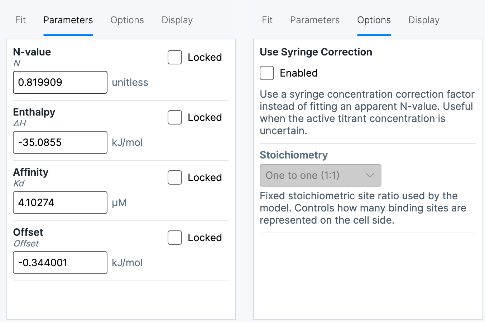

# Single-experiment fitting

In **Analyze Data**, choose **Single experiment**, select a model, review starting values and options, select an uncertainty method, and choose **Run Fit**. Only included injections enter the fit. The concentrations, volumes, temperature, and model options define its scientific inputs.

Review residuals and parameter plausibility afterward. Successful optimizer termination alone does not establish that the model explains the chemistry.

The inspector has four tabs:

- **Fit** selects the model, optimizer, error-estimation method, limits, weighting, and result output. Its **Fit summary** always shows the selected experiment's fitted model, scope, RMSD, and fitted and derived parameters.
- **Parameters** shows the model parameters and their starting or fixed values.
- **Options** contains settings specific to the selected model.
- **Display** controls the fitted curve and diagnostic information shown in the graph. **Guides** draws lines at the fitted stoichiometry and enthalpy. Under **Parameters**, **Show overlay** adds a parameter box to the graph; **Derived parameters** and **Larger text** change only that box, not the fit summary.

In the native macOS Analysis view, the **Parameters** button above the graph shows or hides the parameter box, and **Larger Parameter Text** is in the **Analysis** menu on the right side of the toolbar.

*Analyze Data combines the fitted-heats graph and residuals with the controls for configuring and running the fit.*

Multiple-experiment fitting uses additional experiment selection and parameter constraints; see [Multiple-experiment fitting](07-multiple-experiments.md).

## Injection inclusion

Selecting an injection point in the integrated-heats graph changes whether it is included in the fit. Excluded injections do not contribute to the objective function.

*Excluded injections remain visible when Excluded points is enabled and can be selected for inclusion again.*

Changing injection inclusion does not rerun the fit. The fitted curve and parameters continue to represent the previous fit until **Run Fit** is used again. An inclusion change can also invalidate an Analysis Result that contains the experiment.

## Injection bookkeeping: MicroCal, Ideal continuous mixing, and Discrete displacement

Injection bookkeeping determines the concentrations used by the fit and accounts for reaction heat carried out of the active cell by displaced solution. It does not change measured peak areas or baseline integration.

- **Discrete displacement** is the default starting point for ordinary pulse injections. It assumes that solution is displaced before appreciable mixing, then the remaining cell contents mix with the injected solution.
- **Ideal continuous mixing** assumes mixing throughout the injection. Consider it for injections slow relative to cell mixing or to compare the opposite mixing limit.
- **MicroCal** uses the documented MicroCal concentration and displaced-heat approximations. Choose it when reproducing or comparing MicroCal analyses.

No method is assumed to be empirically superior. Injection bookkeeping is separate from dilution-heat background models and between-reload back-mixing.

**Preferences > Processing > Injection bookkeeping** selects the default for new data. **Experiment Details > Injection bookkeeping** explicitly switches an ordinary experiment and invalidates its fits without reintegrating measured heats. Changing the preference or editing a name/comment does not switch existing data. Older projects retain their saved concentrations and historical heat behavior; if their method is unknown, the selector displays **Saved processing — unchanged**. Choose a method explicitly before recalculating unknown saved concentrations. Rebuild tandem experiments through the tandem tool to change their method.

### Concentrations and injection heat

For MicroCal, let $u$ = cumulative injected volume / active cell volume, $M_{0}$ be the initial cell concentration, and $C_{\mathrm{s}}$ the syringe concentration. Starting with no ligand in the cell:

> **Calculation:**
>
> $$
> M = M_0 \frac{1 - u/2}{1 + u/2}
> $$
>
> $$
> X = C_{\mathrm{s}} u (1 - u/2)
> $$
>
> The first line estimates how much macromolecule remains; the second estimates how much injected ligand is in the cell.

These are approximate concentration curves for the **MicroCal** bookkeeping method. They describe calculated concentrations, not measured curves.

Every delivered injection contributes to cumulative volume, including injections excluded from fitting. The ligand equation is the approximate expression used by FT-ITC for MicroCal processing. The displaced-volume assumptions remain approximate. For a tandem experiment, this calculation stops when cumulative injected volume reaches twice the active cell volume; ideal continuous mixing has no corresponding cumulative-volume limit. Existing projects retain saved concentrations and fits until concentration reprocessing.

For one injection, let $v$ be injection volume, $V$ active cell volume, and $Q$ the equilibrium binding heat content of the cell in joules. The predicted injection heat $q$ depends on the bookkeeping method.

**MicroCal:**

> **Calculation:**
>
> $$
> q = Q_{\mathrm{end}} - Q_{\mathrm{start}} + \frac{v}{V} \frac{Q_{\mathrm{start}} + Q_{\mathrm{end}}}{2}
> $$
>
> The heat change is adjusted for displaced solution using the average of the heat content before and after the injection.

**Ideal continuous mixing:**

> **Calculation:**
>
> $$
> q = Q_{\mathrm{end}} - Q_{\mathrm{start}} + \frac{v}{V} \frac{Q_{\mathrm{start}} + 4Q_{\mathrm{mid}} + Q_{\mathrm{end}}}{6}
> $$
>
> This averages the displaced heat along the mixing path, including the state halfway through the injection.

**Discrete displacement:**

> **Calculation:**
>
> $$
> q = Q_{\mathrm{end}} - \left(1 - \frac{v}{V}\right) Q_{\mathrm{start}}
> $$
>
> Only the fraction of the original cell mixture left after displacement contributes its starting heat.

For Discrete displacement, concentrations advance after each injection as follows:

> **Calculation:**
>
> $$
> M_{\mathrm{end}} = \left(1 - \frac{v}{V}\right) M_{\mathrm{start}}
> $$
>
> $$
> X_{\mathrm{end}} = \left(1 - \frac{v}{V}\right) X_{\mathrm{start}} + \frac{v}{V} C_{\mathrm{s}}
> $$
>
> The same fraction of each starting concentration remains, while the injected solution adds ligand from the syringe.

Discrete displacement follows the formalism described by [Freire, Schön and Velazquez-Campoy (2009)](https://doi.org/10.1016/S0076-6879(08)04205-5). Across a fixed-syringe segment, the retained fractions are multiplied across the injections. Each injection must be smaller than the cell volume, although the total volume injected over the experiment can exceed it. The heat correction uses the cell's pre-injection heat content, which differs from the MicroCal convention and can change fitted values.

For ideal continuous mixing, the midpoint is evaluated halfway through each injection on the changing concentration trajectory. The MicroCal option retains its own heat convention.

The ideal continuous mixing heat calculation is inspired by [Dumas (2022)](https://doi.org/10.1007/s00249-021-01588-4), but uses FT-ITC's finite-injection approximation rather than that paper's imperfect-mixing model. It does not model kinetic single-injection experiments. The calculation uses a fixed integration rule without adaptive refinement, so unusually large injections or sharp transitions need additional scrutiny.

## Parameters and model options

*Parameters exposes parameter values and locks; Options contains settings specific to the selected model.*

The application generates initial parameter values from the experiment and can reuse an attached fitted solution where applicable. Entering a value replaces the generated starting value for that parameter. Values are displayed in the current application units. Clearing a value returns the parameter to automatic initialization.

**Locked** holds a parameter at its displayed value during the primary fit. An unlocked parameter is adjusted by the optimizer. Locked values remain part of the model and affect every other fitted parameter even though they are not estimated by that fit.

Analysis choices are retained separately for the available fitting modes and models, except that changing models resets global constraints to **Independent**. **Restore defaults** clears the stored analysis inputs and reloads the fitting controls from the current preferences. It also resets the inspector's **Unlock parameters** setting. The action does not change preferences, including saved limits, result-output options, and display settings.

Saving a project or applying Preferences preserves the solver and uncertainty choices in the Analysis inspector. Their saved defaults take effect at application startup or through **Restore defaults** in Analysis.

The **Limits** control selects a common parameter-bound policy:

- **Standard** uses the normal parameter bounds.
- **Expanded** permits a wider parameter range.
- **No limits** widens the configured bounds substantially. For affinity, **Expanded** allows $K$ values 20 times lower to 20 times higher than Standard, and **No limits** allows $K$ values 2000 times lower to 2000 times higher. These ranges are widened in $\log_{10} K$ space.

Negative $\log_{10} K$ values represent positive association constants below 1 in the application's affinity units. In multiple-experiment fits, globally constrained affinities controlled by fitted parameters are checked to ensure both $K$ and $K_{\mathrm{d}}$ remain positive and finite. A candidate outside that numerical range is rejected; valid converted values can lie beyond the selected local affinity limits.

A fitted value at a bound is not an interior estimate. It indicates that the reported value depends on the selected bound as well as on the data and model.

Initial guesses outside the selected limits are adjusted to the nearest limit when you choose **Run Fit**. Locked values are preserved, and globally determined values continue to follow their shared constraints.

## Fit execution and diagnostics

**Run Fit** starts the analysis. **Stop** requests cancellation of the active calculation.

While the analysis runs, the status bar identifies the current calculation: fitting, binding assessment, or uncertainty estimation. For independently fitted experiments, it shows the experiment name and position. The secondary status counts completed refits or profile searches.

When the analysis ends, the status bar shows the outcome and total time, followed by the uncertainty outcome. Check a fit that stopped at a limit, or uncertainty reported as incomplete, unavailable, or skipped, before using the result.

The **Display** tab exposes complementary diagnostics:

- **Fit line** shows the curve calculated from the current fitted solution.
- **Residuals** show the difference between each included observation and the fitted curve.
- **Error bars** show the processing-derived integration uncertainty.
- **Confidence band** shows uncertainty around the fitted curve when the solution contains suitable resampling results.
- **Excluded points** shows injections that do not contribute to the current fit.

These displays describe different aspects of the fitted solution. A small RMSD does not rule out systematic residual structure, poorly identified parameters, or dependence on model assumptions.

### Store the fitted solution

With **Create analysis result** disabled, a successful single-experiment solution remains attached to its Experiment Data and is available in that experiment's analysis and figure workflows.

With **Create analysis result** enabled, a usable completed fit also creates a separate Analysis Result containing the experiment, model, fit settings, and solution. **Auto-open new result** determines whether the new result workspace opens immediately. A stopped or unusable fit does not create or replace an Analysis Result.

## Fit availability and non-convergence

A single-experiment analysis requires processed or imported heats and at least three included injections with usable numerical values. The binding models also require nonzero cell and syringe concentrations. **Dissociation** uses the syringe concentration and does not require a macromolecule concentration in the initially buffered cell.

An unavailable model, failed fit, solution at a parameter bound, or large number of failed refits can reflect missing or degenerate heat and concentration information, the supplied starting values, the selected limit policy, the optimizer's interaction with the fitting surface, model complexity, or weak parameter identifiability. Resampling can fail even when the primary fit succeeds because each refit presents a different or reduced dataset to the same model.
## Models

Choose a model based on what is in the cell and syringe and what interactions are plausible. Adding parameters can improve a curve's fit even when the extra binding process is unsupported, so compare residuals and parameter uncertainty as well as the curve. The descriptions below state what each model assumes and reports.

> **Interpretation:** When comparing fitted results from different programs, check the binding model, concentration and stoichiometry definitions, injection bookkeeping, and background-heat or offset treatment. Using the same injection convention does not necessarily make fitted parameters directly interchangeable.

### One-Set-Of-Sites

**One-Set-Of-Sites** represents one class of equivalent, independent binding sites. It fits stoichiometry, dissociation constant, binding enthalpy, and an injection-heat offset. The solution also reports thermodynamic quantities derived from the fitted affinity and enthalpy.

The **Options** tab provides **Use Syringe Correction** and **Stoichiometry**. Without syringe correction, the fitted **N-value** represents the apparent site stoichiometry. With syringe correction enabled, **Stoichiometry** fixes the number of cell-side sites and **Correction factor** ($\alpha$) scales the delivered titrant concentration. Enter or lock $\alpha$ in the parameter row; set the fixed site ratio under **Stoichiometry**.

The model cannot by itself distinguish concentration uncertainty from other effects that change an apparent stoichiometry.

#### Calculation and assumptions

Let $M$ be the total macromolecule concentration, $N$ the number of sites per macromolecule, $X$ the total ligand concentration, $x$ the free ligand concentration, and $K_{\mathrm{d}}$ the dissociation constant. A smaller $K_{\mathrm{d}}$ means stronger binding. The model finds $x$ by balancing free and bound ligand, then calculates the heat content $Q$ of the cell:

> **Calculation:**
>
> $$
> f = \frac{x}{K_{\mathrm{d}} + x}
> $$
>
> $$
> X = x + N M f
> $$
>
> $$
> Q = V N M f\,\Delta H
> $$
>
> The fraction $f$ tells us how many sites are occupied. The middle line counts free ligand plus ligand on the sites. The last line multiplies the amount bound in cell volume $V$ by the heat per mole bound, $\Delta H$. Injection heat then follows the selected bookkeeping calculation above.

### Two-Sets-Of-Sites

**Two-Sets-Of-Sites** represents two independent classes of sites. It fits separate stoichiometries, dissociation constants, and enthalpies for the two classes, together with a shared injection-heat offset.

**Shared N-Values** makes the two site classes use the same fitted stoichiometry. **Use Syringe Correction** instead fixes the first and second **Stoichiometry** values and fits one active syringe-concentration factor, `alpha`.

With syringe correction on, set the two fixed stoichiometries independently. **Shared N-Values** applies only when syringe correction is off.

The two site labels are interchangeable: exchanging all parameters assigned to site 1 and site 2 describes the same physical model. A lower RMSD or optimizer objective alone does not establish that two distinguishable binding processes are supported by the experiment.

#### Calculation and assumptions

Each class has its own site count $N$, affinity $K_{\mathrm{d}}$, and binding enthalpy $\Delta H$. With free ligand concentration $x$, the two classes share the same supply of ligand:

> **Calculation:**
>
> $$
> f_j = \frac{x}{K_{\mathrm{d},j} + x}, \quad \text{for } j = 1 \text{ or } 2
> $$
>
> $$
> X = x + M(N_1 f_1 + N_2 f_2)
> $$
>
> $$
> Q = V M(N_1 f_1 \Delta H_1 + N_2 f_2 \Delta H_2)
> $$
>
> Each $f$ is the occupied fraction for one site class. The ligand balance finds one free concentration that satisfies both classes. Their heat contributions add to give the cell heat content; injection bookkeeping converts its change to a predicted heat.

### Sequential Binding Sites

**Sequential Binding Sites** represents two, three, or four ordered binding steps on a macromolecule in the cell. **Sequential binding steps** in the **Options** tab selects the number of steps. The model fits one macroscopic stepwise association constant and one molar step enthalpy for each transition, together with the ordinary molar injection-heat offset. It does not fit an N-value or syringe activity.

The reported $K_{i}$ values are phenomenological, macroscopic step
constants for the ordered transitions $M \to MX \to MX_2$ and so on.
They are not microscopic intrinsic site constants. Step numbers therefore have
a physical order, so fitted steps are never sorted or treated as interchangeable.

The macromolecule must be in the cell and ligand in the syringe. Reverse
titrations with macromolecule in the syringe are outside this model. Multi-step
fits can be weakly identifiable, especially when the concentration window does
not populate every transition. Inspect parameter bounds, residuals, bootstrap
uncertainty, and parameter correlations; an improved RMSD does not by itself
establish the selected number of sequential steps.

#### Sequential-state calculation

For step count $n$, let $\beta_0 = 1$,
$\beta_i = \prod_{j=1}^{i} K_j$, and let $x$ be the free ligand concentration.
The state weights and fractions are

> **Calculation:**
>
> $$
> w_i = \beta_i x^i
> $$
>
> $$
> F_i = \frac{w_i}{\sum_{j=0}^{n} w_j}
> $$
>
> $$
> \bar{\nu} = \sum_{i=0}^{n} i F_i
> $$
>
> $$
> X_{\mathrm{t}} = x + M_{\mathrm{t}} \bar{\nu}
> $$
>
> Each state receives a weight from its binding steps and the available free ligand. Dividing by the total weight gives the fraction in that state. The average number of bound ligands, $\bar{\nu}$, then balances free and bound ligand against the total.

Here $M_{\mathrm{t}}$ and $X_{\mathrm{t}}$ are total macromolecule and ligand
concentrations in the cell. The model solves the ligand balance as part of the fit and
calculates the cell heat content from the population of every sequential state:

> **Calculation:**
>
> $$
> Q = V M_{\mathrm{t}} \sum_{i=1}^{n} F_i \left(\sum_{j=1}^{i} \Delta H_j\right)
> $$
>
> For each state, add the heats of all steps needed to reach it, multiply by the fraction in that state, and sum across states. Multiplying by the macromolecule amount in the cell gives its heat content.

### Competitive Binding

**Competitive Binding** represents titration of a target ligand into a macromolecule that is initially in equilibrium with a prebound ligand in the cell. It fits the target ligand's stoichiometry, dissociation constant, binding enthalpy, and injection-heat offset.

The **Options** tab requires the pre-equilibrated competitor's **Total competitor** concentration, **Ligand Affinity**, and **Ligand Enthalpy**. **Total competitor** includes both free and bound competitor in the cell. Each option can use an experiment attribute instead of a manually entered value. For affinity and enthalpy, add a **Competitor properties** attribute and select a one-set-of-sites Analysis Result to supply $K_{\mathrm{d}}$, $\Delta H$, and their uncertainty. Different experiments in a global fit can select different source results: eg if using a different competitor. The model also provides **Use Syringe Correction** and **Stoichiometry** with the same concentration-factor interpretation as One-Set-Of-Sites.

With **From attributes** selected, the next fit uses each experiment's attribute value; the manually entered option is used when **From attributes** is off. Every included experiment needs the required attributes, or the fit cannot start. The Analysis Result **Model** page identifies attribute-supplied options and the values used for each experiment. **Update Result** reads current attributes; an existing result does not update when attributes change and retains the values used in its earlier fit until updated.

The **Total competitor** attribute also accepts an SD for its concentration.

If the source result has temperature dependence, its values are evaluated at the experiment temperature. Otherwise its summary temperature is used, with a notice when the temperatures differ. Removing a source after fitting does not erase values already used by a result; a source removed before its values were used must be restored or replaced. Updating the source result marks dependent results out of date until they are fitted again. Residual bootstrap samples the supplied affinity and enthalpy uncertainties separately, as it does for manually entered model options.

The **Ligand Affinity** and **Ligand Enthalpy** labels describe the pre-equilibrated competitor's properties. The fitted target affinity and enthalpy depend on those supplied properties. The competitor properties are model inputs, not quantities independently determined by this fit.

The reported apparent target $K_{\mathrm{d}}$ includes a competition factor calculated from the initial free competitor concentration. This calculation accounts for competitor already bound to cell sites rather than substituting the total competitor concentration. The apparent target $K_{\mathrm{d}}$ can therefore differ from its intrinsic value.

#### Calculation and assumptions

The target ($A$) and competitor ($B$) compete for the same sites. Let $a$ and $b$ be their free concentrations, $K_{\mathrm{a},A}$ and $K_{\mathrm{a},B}$ their association constants, and $S$ the total site concentration. The model solves for the two free concentrations so that the available ligand is accounted for:

> **Calculation:**
>
> $$
> D = 1 + K_{\mathrm{a},A} a + K_{\mathrm{a},B} b
> $$
>
> $$
> f_A = \frac{K_{\mathrm{a},A} a}{D}
> $$
>
> $$
> f_B = \frac{K_{\mathrm{a},B} b}{D}
> $$
>
> $$
> A_{\mathrm{total}} = a + S f_A; \quad B_{\mathrm{total}} = b + S f_B
> $$
>
> $$
> Q = V S(f_A \Delta H_A + f_B \Delta H_B)
> $$
>
> $D$ counts the empty and occupied possibilities for a site; $f_{A}$ and $f_{B}$ are the occupied fractions. The two ligand balances count free plus bound molecules. Each bound population contributes its own heat. The competitor's affinity and enthalpy are supplied inputs; the target's are fitted.

### Dissociation

**Dissociation** describes dimers in the syringe solution separating into free components when injected into a cell initially containing buffer. Dilution shifts the equilibrium toward free components. This includes a 1:1 complex of two different components (a heterodimer) when they are present in equal amounts. The model fits an effective dissociation constant, the heat per mole of dimers formed, and an injection-heat offset.

The integrated-heats and residual plots use the total titrant concentration in the cell after each injection, in µM. This concentration is calculated from the entered concentrations and injection bookkeeping.

For an equimolar complex $A + B \rightleftharpoons AB$, enter the syringe concentration as the **sum of the concentrations of A and B units** (twice the concentration of an equimolar $AB$ preparation). Then $F = [A] + [B]$ and $P = [AB]$. Because $[A] = [B] = F/2$, the usual heterodimer association constant $K_{\mathrm{a},AB} = [AB]/([A][B])$ is **four times** the model's $K_{\mathrm{a,model}}$; the usual heterodimer $K_{\mathrm{d}}$ is one quarter of the fitted $K_{\mathrm{d}}$. The fitted $\Delta H_{\mathrm{assoc}}$ is per mole of $AB$ formed. The model does not represent unequal component amounts, separate component concentrations, or other oligomerization schemes. It has no stoichiometry or syringe-correction options.

#### Dissociation calculation

> **Calculation:**
>
> $$
> K_{\mathrm{a,model}} = \frac{P}{F^2}
> $$
>
> $$
> C = F + 2P
> $$
>
> $$
> Q = V P\,\Delta H_{\mathrm{assoc}}
> $$
>
> $F$ is the concentration of free components counted together, $P$ is the concentration of dimers, and $C$ counts two components per dimer. The equilibrium determines how much remains dimerized at each dilution. The cell heat content is the amount of dimer times the heat of forming it. Dilution drives dimers apart, so dissociation heat has the opposite sign from the fitted association enthalpy. Injection bookkeeping also accounts for associated species carried in from the syringe.

With **MicroCal** bookkeeping, Dissociation uses MicroCal's own dimer-dissociation equation instead of the averaged displaced-heat formula used for the binding models. The displaced solution leaves with the cell content from before the injection, while concentrations still follow the MicroCal equations. With $v$ the injection volume, $V$ the active cell volume, and $P_{\mathrm{syr}}$ the dimer concentration in the syringe:

> **Calculation:**
>
> $$
> q = \Delta H_{\mathrm{assoc}}[V P_{\mathrm{end}} - (V - v)P_{\mathrm{start}} - v P_{\mathrm{syr}}]
> $$
>
> The last term counts the dimers delivered by the injection as part of the starting amount, so heat comes only from the change in dimer amount, mainly dissociation of injected dimers as they are diluted. MicroCal's concentration and heat equations treat displaced solution differently, so they do not balance exactly. Use this combination to compare with MicroCal results.

### Thermodynamic relationships

The application derives thermodynamic quantities from the fitted affinity and enthalpy. Temperature $T$ is expressed in kelvin.

> **Calculation:**
>
> $$
> K_{\mathrm{d}} = \frac{1}{K_{\mathrm{a}}}
> $$
>
> $$
> \Delta G = R T \ln(K_{\mathrm{d}}) = -R T \ln(K_{\mathrm{a}})
> $$
>
> $$
> -T\Delta S = \Delta G - \Delta H
> $$
>
> Here, $R$ is the gas constant, and the final relationship matches the **−TΔS** quantity reported by the application.

## Fitting calculation

### Algorithm

**Levenberg-Marquardt** uses local derivative information and can be efficient when the starting values describe a suitable region of the fitting surface.

**Nelder-Mead** is a derivative-free simplex optimizer. It provides an alternative when the derivative-based method has difficulty converging from the chosen starting values.

### Weight by injection error

**Weight by injection error** uses the integration uncertainty estimated during thermogram processing when calculating the fitting objective. An injection with a larger estimated error has less influence on the fitted parameters than one with a smaller estimated error. Choose this only when those processing-derived error estimates are suitable for the dataset.

**RMSD** summarizes the typical size of the heat differences between the observed points and the fitted curve. It is always calculated from the unweighted residuals, including after a weighted fit. The result tooltip reports the optimizer objective separately: the raw residual sum of squares for unweighted fitting or the standardized residual sum of squares for weighted fitting. Weighting can change the fit even though the displayed RMSD remains an unweighted summary.

For a multiple-experiment result, the displayed global RMSD is pooled across every included injection in every member experiment. Each member row retains its own local RMSD, so the global value remains comparable when members contain different numbers of included injections.

**Weight by injection error** is available only when every included injection has a finite, positive peak-area SD. The application checks this again before fitting. An injection without an estimated SD can be excluded from the fit, or its thermogram can be reprocessed to obtain an estimate.

The weighting describes the application's processing-derived uncertainty model. It does not account for every systematic source of experimental or processing uncertainty.

#### Objective calculation

> **Calculation:**
>
> $$
> r_i = q_{i,\mathrm{obs}} - q_{i,\mathrm{model}}
> $$
>
> $$
> \mathrm{RMSD} = \sqrt{\frac{\sum r_i^2}{N}}
> $$
>
> $$
> \text{weighted objective} = \sum \left(\frac{r_i}{\sigma_i}\right)^2
> $$
>
> Only included injections enter these sums, and $N$ is their number. The value $\sigma_{i}$ is the processing-derived uncertainty for injection $i$; weighting changes the fitting objective but does not remove systematic uncertainty.

## Parameter uncertainty

The reported value is the best fit to the original data. Choose **Errors** to estimate uncertainty or sensitivity afterward:

- **None:** keep the primary fit without parameter uncertainty.
- **Bootstrap residuals:** estimate variation under resampled residual noise.
- **Leave-one-out:** assess sensitivity to omitting an injection or, for a global fit, an experiment.
- **Profile likelihood:** search for a 95% interval while refitting the remaining free parameters.

**Bootstrap** sets the requested number of residual-bootstrap iterations. It is enabled and used only for residual bootstrap; leave-one-out and profile likelihood have deterministic schedules and do not use this count. Only included injections supply residuals, and only retained usable refits enter the parameter distributions. Because residual-bootstrap sampling is with replacement, one residual can occur more than once in a synthetic dataset while another may not occur at all. The fit status distinguishes successful and failed refits.

Correlation diagnostics distinguish all attempted refits, those with usable optimizer results, and complete refits with finite values for every displayed parameter. If many refits fail, the retained set may not represent the full range of resampled outcomes. Increasing the requested count improves Monte Carlo precision but does not resolve systematic refit failures.

Rerunning a bootstrap can give slightly different uncertainty estimates because it draws a new random sample.

For a stored bootstrap result, **Update Result** offers the stored request or another supported count. It creates a fresh fit and bootstrap rather than appending samples. Canceling or retaining no usable refits preserves the previous result.

### Residual-bootstrap calculation

Residual bootstrap samples from the included injections' primary-fit residuals and adds each draw to a best-fit prediction. An unweighted fit centers and samples raw residuals, assuming roughly equal residual spread across injections. A weighted fit divides by each injection's peak-area SD before centering and sampling, then multiplies each draw by the target injection's SD.

Fitted residuals underestimate noise because fitting absorbs some variation. The centered residuals are therefore multiplied by $\sqrt{n/(n-p)}$, where $n$ is the number of included injections and $p$ the number of free fitted parameters; locked parameters are not counted. This matches the residual variance estimate $\mathrm{RSS}/(n-p)$, where RSS is the residual sum of squares. Without the correction, small-dataset intervals would be too narrow. Shared global fits use pooled counts; independent experiments use their own. In either case, $n$ must exceed $p$.

The primary best-fit parameter remains the reported value. For a parameter with best-fit value $\hat{\theta}$ and values $\theta_{b}$ from $B$ retained refits, the application summarizes the bootstrap distribution as follows:

> **Calculation:**
>
> $$
> \mathrm{SD} = \sqrt{\frac{\sum_b (\theta_b - \hat{\theta})^2}{B}}
> $$
>
> $$
> 95\%\ \mathrm{CI} = \left[P_{2.5}(\{\theta_b\}), P_{97.5}(\{\theta_b\})\right]
> $$
>
> SD is the root-mean-square deviation of the retained refits from the primary best fit. The confidence limits are the 2.5th and 97.5th percentiles of the retained refit distribution itself, so they need not be equally spaced around the best fit. Neither calculation replaces the best-fit value with the bootstrap mean or median.

The uncertainty display can show SD, the 95% confidence interval, both, or select between them automatically. This presentation rule is described under [Uncertainty and evaluation temperature](08-results-advanced-analysis.md#uncertainty-and-evaluation-temperature).

### Leave-one-out calculation

Leave-one-out performs one deterministic refit per included injection in a single-experiment analysis, or per omitted experiment in a global fit. Concentrations, uncertain model options, and parameter locks remain at their primary-fit values, so the spread measures sensitivity to omission under those fixed inputs.

### Profile-likelihood uncertainty

**Profile likelihood** estimates parameter uncertainty by asking how far a fitted parameter can be moved away from its best-fit value before agreement with the data crosses the chosen threshold. Profile likelihood does not create a refit ensemble or a confidence band.

For each trial, the selected parameter is fixed while the other free parameters readjust. Searching both directions allows compensation between parameters. Independent fits use their local objective; shared global fits use the complete objective and its free coordinates.

The 95% confidence limits are the parameter values at which the best achievable fit reaches a statistically defined 95% threshold. FT-ITC uses an F-calibrated threshold based on the number of observations and fitted parameters. The confidence interval is therefore determined by the shape of the fit surface rather than by assuming that parameter uncertainty is symmetric or normally distributed.

A complete interval is reported only when the threshold is crossed on both sides of the best-fit value. If the search reaches a parameter limit first, that side is recorded as censored and has no confidence endpoint. For a complete interval, the displayed `value ± SD` uses a symmetric display equivalent calculated from the asymmetric interval; it is not a sample standard deviation. Save the result in an `.ftxtc` project to preserve the profile diagnostics.

After **Update Result**, check whether the completion message says the previous profile result was retained rather than replaced.

### Concentration uncertainty

With **Concentration uncertainty** enabled in the **Fit** tab, the concentration SDs entered in **Details...** are propagated through residual-bootstrap calculations. The control is initialized from the corresponding preference and is active only for residual bootstrap; leave-one-out and profile likelihood keep primary concentrations fixed. Each nonzero fractional SD is the arithmetic standard deviation relative to the entered concentration.

Bootstrap concentration variations use a positive lognormal multiplier with mean 1 and the entered fractional SD $c$. Specifically, $\sigma_{\mathrm{log}}^2 = \ln(1 + c^2)$, $\mu_{\mathrm{log}} = -\sigma_{\mathrm{log}}^2/2$, and the multiplier is $\exp(\mu_{\mathrm{log}} + \sigma_{\mathrm{log}} Z)$ for a standard-normal $Z$. This chosen distribution keeps sampled concentrations positive while preserving the entered arithmetic mean and SD; it does not change the concentrations used for the primary best fit. If a concentration has no entered SD, that concentration remains fixed in bootstrap refits. These uncertainties affect the synthetic experiment concentrations used for bootstrap refits.

### Displayed parameter uncertainty

Uncertainty is shown in the same units and parameter form as the reported value. For example, affinity is fitted as $\log_{10}(K_{\mathrm{a}})$ but normally displayed as $K_{\mathrm{d}}$; its SD is propagated through that conversion, and its percentile limits are transformed and ordered on the display scale. The central value remains the best fit to the original data, and this nonlinear conversion can make the displayed interval asymmetric.

Standard and Strict precision round halfway values away from zero, so mirrored positive and negative estimates and interval limits round symmetrically.

Quantities calculated from more than one reported parameter, such as $-T\Delta S$, use the application's uncertainty-propagation rules for that calculation. Their displayed limits are therefore not necessarily the percentiles that would be obtained by recalculating the complete derived quantity independently for every bootstrap refit. The **Automatic** SD-or-CI decision is applied after transformation or propagation, separately for each displayed quantity.

### Unlock parameters during error estimation

**Locked** parameters remain fixed during the primary fit. With **Unlock parameters** enabled, copies of those parameters are unlocked only for residual-bootstrap refits and can vary in the resampled solutions. Leave-one-out and profile likelihood always preserve the primary-fit locks.

This setting does not change or rerun the primary best fit. It changes only the parameter state used by the repeated error-estimation fits, and it has no effect when no fitted parameter is locked.
