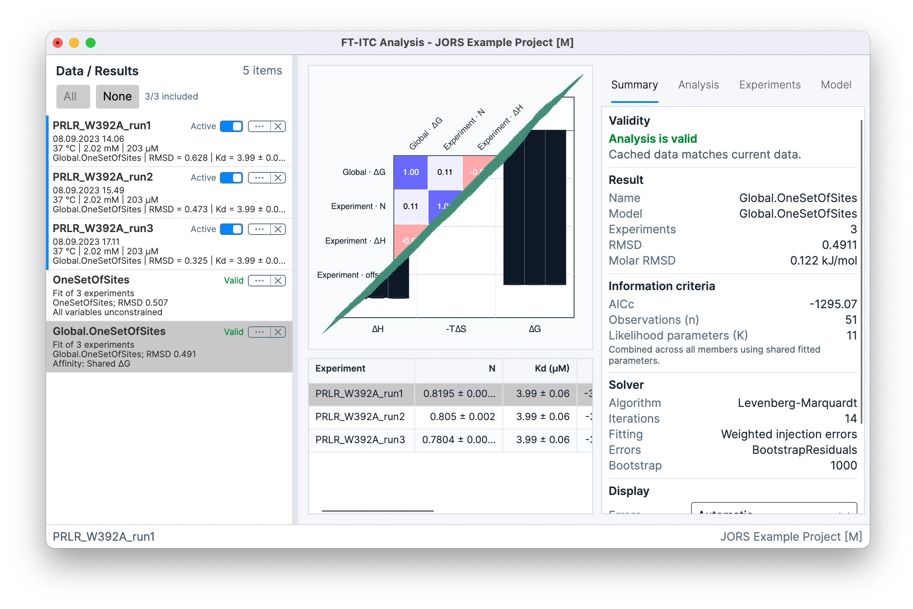

# Results and advanced analyses

An **Analysis Result** saves a fit so you can inspect and export it later. Start with the fitted values and graph, then check where the predicted heats differ from the measured heats. The uncertainty display describes how precisely the parameters were estimated under the chosen model; the validity indicator tells you whether the saved fit still matches the experiment data currently in the project.

For fit setup, see [Single-experiment fitting](06-fitting-models.md) and [Multiple-experiment fitting](07-multiple-experiments.md). This chapter explains the saved result, its validity, and how to interpret its outputs.

## Result views

The result view selector contains **Fit**, **Correlation**, and **Summary** for every Analysis Result. Thermodynamic temperature plots and parameter evaluation can show every active step in a sequential binding model. **Temperature** (temperature dependence and structuring), **Salt**, and **Protonation** appear only when the selected model defines those analyses and the member metadata satisfy their additional requirements.

**Summary** presents the combined parameter graph and result table. The table can show fitted values, derived values, and the selected uncertainty representation for each stored solution.

Molar-energy values use a common displayed unit; $\Delta C_{\mathrm{p}}$ can use a different unit.

Select a member row to view its **Fit** and available **Correlation** information. Use **Preferences > General > Energy units** to choose joules or calories.

Advanced analyses can sample the stored values and uncertainty summaries from profile-likelihood results. This does not provide a bootstrap ensemble or a joint model of parameter covariance. Saved leave-one-out refits can provide an envelope on the integrated-heats graph.

**Fit** presents the saved fitted curve, residuals, error bars, confidence band, and excluded points for the selected member. The graph is read-only: it represents the stored solution and does not expose fit controls or alter the underlying experiment.

**Correlation** presents a matrix calculated from residual-bootstrap refits. Its availability, scope, and interpretation are described under [Parameter correlation](#parameter-correlation).

## Result details

Open a saved result's details to edit its name and comments and inspect its saved fit information. On native macOS, **Result Details** opens as a sheet with three tabs:

- **Details** contains the name, read-only date, saved **Analysis operator**, comments, and a summary of the model, fit metrics, solver, uncertainty settings, and validity reasons.
- **Experiments** lists the result's member experiments, including their dates, temperatures, and solution status.
- **Actions** provides **Copy result table**, **Load solutions to experiments**, and **Select result experiments**. Selection includes the experiments belonging to this result and excludes the others in the current project. Copying uses the preferred energy-unit family and temperatures in Celsius.

**Apply** saves a nonblank name and the comments; **Cancel** discards those pending edits.

The saved **Analysis operator** records the operator associated with the fit when the result was created or last successfully updated. Results without a saved name show **Not recorded**.

## Inspector tabs

The result inspector has four tabs with shared labels across the supported desktop versions: **Summary**, **Analysis**, **Experiments**, and **Model**.

The **Summary** tab contains the result identity, model, member count, RMSD, validity, information criteria, and solver diagnostics. Solver information includes algorithm, iterations, whether injection-error weighting was used, and the uncertainty method. Uncertainty status describes whether estimates are complete, incomplete, cancelled, unavailable, or intentionally skipped because no binding was detected.

**Bootstraps** shows the requested number of refits; its tooltip gives the retained count when it differs. Reports use complete retained replicates. Older results without a saved request show **Unknown**. For mixed independent results, eligible experiments retain their own uncertainty, but a complete combined set is unavailable. **Update Result** can rerun the stored request or use any offered count, including the same or a smaller count.

In the browser viewer, RMSD is shown as a saved unweighted display diagnostic in µJ, separate from the weighted fitting objective. When the saved convergence record contains it, **Molar RMSD (kJ/mol)** is shown separately: the result summary uses the saved global metric, while an individual fit uses that fit's saved metric. Missing or non-finite saved values remain unavailable; member values are not averaged to reconstruct the result metric.

Competitor properties in viewer metadata show captures saved on the experiment; these may differ from the values used by a particular saved fit.

The **Analysis** tab contains the result view selector, parameter evaluation, and the analysis-specific controls and outputs. It is also the location of the uncertainty display, correlation information, and evaluation-temperature presentation associated with the selected view. Energy units are chosen consistently from the displayed central values and are also used for graph axes, errors, fitted bands, tooltips, and parameter lists.

The **Experiments** tab lists the result members and their stored status and condition information, including member temperature. The row selected in the result table determines which experiment appears in **Fit**; this tab provides that experiment's details.

The **Model** tab shows the stored model options, locked parameters and their fixed values, and the active constraints. Constraints with state **Independent** are not listed as active global constraints. Affinity constraints are labelled **Independent**, **Shared Kd**, **Shared ΔG**, or **Thermodynamically linked** to describe the fitted relationship precisely; other parameters use **Shared** and, where supported, **Temperature dependent**.

### Result validity

Validity answers whether the saved fit still describes the experiment inputs currently in the project. FT-ITC compares the result's saved inputs with the current member experiments, including their temperature, concentrations, cell volume, injection bookkeeping, included injections and heats, relevant processing and attributes, and tandem segment layout. Changing a result name or attaching a different solution to an experiment does not by itself change this status. Validity does not say whether the model is scientifically appropriate or the fit is good.

- **Analysis is valid** means the saved fit inputs still match.
- **Partially invalid** means some members of a multiple-experiment result fitted independently without temperature dependence have changed, while others still match. A shared-parameter fit or a result with temperature dependence is treated as invalid when any member's fit inputs change, including when its members were fitted individually.
- **Invalid** means the saved fit no longer matches the current inputs, or the set of member experiments has changed.
- **Unknown status** means FT-ITC cannot make the comparison, for example because an older result has no validity snapshot.

Check the listed validity reasons and use **Update Result** when inputs have changed. Stored fitted parameters continue to describe the earlier inputs until updated.

Removing any source experiment from the experiment browser makes the whole result **Invalid** and names the missing experiment. **Undo** restores the previous validity when it restores the original experiment unchanged.

Analysis warnings are separate from validity: a matching fit can still reach a parameter bound, encounter an uncertainty limit, or have an **Inconclusive** member. A manual **Binding detected** conclusion clears only that member's Inconclusive warning. No-binding members' boundary and uncertainty-limit warnings remain listed with the experiment but do not contribute to result status. Repeated desktop reasons are summarized by category and count; the browser likewise distinguishes saved analysis warnings from input validity.

### Information criteria

**AIC** and **AICc** help compare candidate models fitted to the same observations. They balance agreement with the data against the number of fitted parameters; a smaller value is preferred within a comparable set. They do not tell you that any model is scientifically correct.

Read **Information criteria** for the analysis-level AICc, or AIC when its small-sample correction is unavailable, plus observation and parameter counts. AICc requires $n > K + 1$. If the likelihood is unavailable, inspect the displayed reason.

For independent fits, the **AICc / AIC** column compares alternative models for the same experiment, observations, response definition, and weighting mode. Do not compare scores across different experiment rows. Shared-parameter fits show only the analysis-level criterion. Prefer AICc when available; neither criterion establishes model adequacy.

#### Likelihood calculation

The criteria use the saved result's included injections and response definition. At analysis level, residual statistics are pooled before estimating the variance, including when members were fitted independently. Unweighted criteria estimate one common variance across all members; weighted criteria estimate one common multiplier of the injection-error variances. Each independent member's own criterion estimates its variance separately. Consequently, neither pooled AIC nor pooled AICc is a sum of the member values.

With residuals $r_{i}$, raw residual sum of squares $\mathrm{RSS} = \sum r_i^2$, integration-error SDs $\sigma_{i}$, and standardized residual sum of squares $Q = \sum (r_i/\sigma_i)^2$, the maximized likelihood terms are:

For an **unweighted fit with one estimated common variance**:

> **Calculation:**
>
> $$
> -2\log L = n[\log(2\pi\mathrm{RSS}/n) + 1]
> $$
>
> This estimates one shared residual variance from the total squared mismatch $\mathrm{RSS}$, then scores how likely the observed heats are under that estimate.

For a **weighted fit with one estimated variance multiplier**:

> **Calculation:**
>
> $$
> -2\log L = n[\log(2\pi Q/n) + 1] + \sum \log(\sigma_i^2)
> $$
>
> This uses each injection's processing SD $\sigma$ as a relative weight. The score also includes their different uncertainty scales.

Weighted criteria use the processing SDs as relative measures of injection uncertainty and estimate one common variance multiplier, $Q/n$, from the standardized residual score $Q$ and observation count $n$. This does not change those SDs or the fitted parameters. Every included injection needs a positive SD for weighted fitting. A score is unavailable when residual variance is zero. Weighted profile-likelihood intervals retain the relative weights and use the estimated overall residual scale for their threshold.

The fitted parameter count $p$ includes only parameters free in the saved global model. Shared coordinates count once; member-specific coordinates count once per member. For a member criterion, $p$ includes only that member model's free fitted parameters. In both weighting modes, the reported values use $K = p + 1$, $\mathrm{AIC} = -2\log L + 2K$, and $\mathrm{AICc} = \mathrm{AIC} + 2K(K + 1)/(n - K - 1)$. This standard small-sample correction is an approximation for nonlinear ITC models.

### Binding assessment

Review the automatic conclusion beside the fit and residuals. **No binding detected** means this experiment does not establish binding relative to the Null model; it does not establish that the molecules cannot bind. Use **Modify Assessment** to override the conclusion or restore automatic assessment. Updates recalculate the automatic outcome and retain manual overrides; reopening applies the current rule to saved comparison evidence without refitting. Assessments are saved in `.ftxtc` projects.

**Null prediction** overlays the model fit on the integrated-heats graph; the original binding fit remains available. In the native macOS Analysis view, choose **Show Null Prediction** from the **Analysis** menu on the right side of the toolbar.

Uncertainty estimation (bootstrap, leave-one-out or profile likelihood) is not run for a fit assessed as **No binding detected**, because its parameters are not expected to be meaningful; its uncertainty is shown as **Not estimated (no binding detected)**. In an independent collection this applies to each experiment separately, and combined uncertainty is then unavailable. Manual assessments count: if you mark such a fit **Binding detected**, the result is marked stale until **Update Result** estimates its uncertainty.

Independent experiments have individual assessments. **Member assessments** shows a common conclusion or **Mixed assessments**, including manual overrides; it is not a joint statistical verdict. Inconclusive members retain binding values and uncertainty. **Not assessed** imposes no restriction and is not positive evidence. If any member is effectively **No binding detected**, combined binding values and dependent analyses are omitted, with those members named; values are never recomputed from a subset. A pooled comparison is diagnostic only. A shared global fit instead has one result-level assessment.

**Standard reports** retain every member and its model, options, scope, constraints, fixed settings, and fit details. No-binding parameter and RMSD cells are blank; their parameter tables, c-values, correlations, and fit warnings are omitted. **No binding detected** and **Inconclusive** appear under the experiment name. Unavailable estimates use **—**, distinct from suppressed blank cells. Standard no-binding figures show the Null prediction against buffer-corrected observations without fitted offset correction. Manual conclusions are marked **(manual)**, including collection summaries with an overridden member. Thermodynamic summary plots omit no-binding members in both Standard and Diagnostic reports, name the omissions, and disappear if none remain. Inconclusive members retain binding output.

Standard result-table exports continue to omit no-binding members' binding values and RMSD, while keeping their ionic strength and ionization enthalpy; Inconclusive values are included. **Diagnostic report** and **Diagnostic export** retain available attempted binding detail, including every member's estimates, labels, and fit warnings, and full comparison evidence. Diagnostic reports place pooled comparison evidence for independent collections in **Pooled Comparison Diagnostics**; Diagnostic Summary exports place it in separately labelled pooled-diagnostic columns. This evidence uses a pooled variance convention and does not determine member assessments.

#### Null comparison calculation

A null hypothesis is the simplest explanation of the data that you want to rule out before trusting a more detailed model. For a titration, the null hypothesis is that the measured heats can be explained without binding. A Null model represents that no-binding explanation, including heat from dilution and mixing. If a binding model does not describe the data clearly better than this background alone, its fitted affinity, enthalpy, and stoichiometry are not supported by the data.

The comparison uses the Offset Null model, which predicts each injection heat as $q_i = b m_i$, where $m_{i}$ is the amount injected and $b$ is a constant background heat per mole of injectant. It uses the same included injections and weighting as the binding fit. The analysis inspector shows the automatic conclusion; use **Modify Assessment** on the saved result to change it manually or return to automatic assessment. The Summary shows the Null model RMSD and the signed $\Delta\mathrm{AICc}$. For multi-experiment results, the Null model is fitted separately for each experiment using the ordinary single-experiment fit. A locked or shared binding-model does not constrain these local Null model fits. For independently fitted binding models, each local comparison determines its member assessment. For pooled shared-parameter binding fits, all local null fits are combined under the pooled variance convention to calculate the result-level comparison.

The two fits are compared with AICc (see [Information criteria](#information-criteria)), which balances fit quality against the number of fitted parameters:

> **Calculation:**
>
> $$
> \Delta\mathrm{AICc} = \mathrm{AICc}_{\mathrm{null}} - \mathrm{AICc}_{\mathrm{binding}}
> $$
>
> A positive value favors binding because the Null model has the higher AICc. It does not establish that the selected binding model is adequate or correct. A negative $\Delta\mathrm{AICc}$ value indicates that the Null model is favored.

The chosen cutoffs are **No binding detected** at $\Delta\mathrm{AICc} \leq 0$, **Inconclusive** at $0 < \Delta\mathrm{AICc} < 15$, and **Binding detected** at $\Delta\mathrm{AICc} \geq 15$. They have no calibrated false-positive guarantee; the comparison is not a significance test.

## Uncertainty and evaluation temperature

The central value is the model's best fit to the original data. An uncertainty display gives a range or spread around that value under the selected estimation method. It does not include every possible experimental error or guarantee that the chosen model is correct.

The **Errors** display control provides **Automatic**, **Standard deviation**, **95% confidence interval**, and **SD + 95% CI**. **Standard deviation** presents the primary best-fit value with a symmetric ± SD; **95% confidence interval** presents that same best-fit value with its lower and upper confidence limits; and **SD + 95% CI** presents both. The central value is always the primary best fit, not the mean or median of the resampled values. Residual-bootstrap intervals use percentile limits; profile-likelihood intervals use the likelihood-threshold endpoints, with an equivalent symmetric scale for the SD display.

The **Parameter Evaluation** section contains an evaluation **Temperature** field and the displayed thermodynamic quantities at that temperature. Its default is the current **Reference temperature** when the measured temperature span exceeds the configured minimum, including independently fitted series; otherwise it is the mean experiment target temperature. Temperature display can be **Celsius** or **Kelvin**. Results remembers this unit for the current application session, independently of the result exporter. Both start from **Preferences > Temperature units**; changing that preference resets both choices. Switching units preserves the physical evaluation temperature. Changing the evaluation temperature updates the displayed quantities calculated from the stored model; it does not change injection heats or refit the result. Temperature-dependent values are meaningful together with their model, units, uncertainty representation, and evaluation temperature.

Changing **Errors** changes only how stored uncertainty is presented in tables, parameter evaluation, and graphs. It does not rerun the fit, change the best-fit parameters, or turn one error-estimation method into another. Bootstrap construction, parameter transformation, and the SD and percentile calculations are described under [Parameter uncertainty](06-fitting-models.md#parameter-uncertainty).

### Automatic display calculation

**Automatic** shows the 95% confidence interval when the interval is clearly lopsided around the best-fit value, and SD otherwise. In practice, CI is shown when the longer side of the interval is at least about 1.44 times the shorter side. A symmetric `value ± SD` would misrepresent such an interval, so its limits are shown instead.

The choice is made separately for each reported quantity. Let $L$ and $U$ be its stored 95% confidence limits and $\hat{\theta}$ its primary best-fit value:

> **Calculation:**
>
> $$
> w_{\mathrm{lower}} = \hat{\theta} - L; \quad w_{\mathrm{upper}} = U - \hat{\theta}
> $$
>
> $$
> \text{asymmetry} = \frac{\lvert w_{\mathrm{upper}} - w_{\mathrm{lower}} \rvert}{w_{\mathrm{upper}} + w_{\mathrm{lower}}}
> $$
>
> Automatic shows the 95% confidence interval when both widths are positive and the asymmetry is at least 0.18; otherwise it shows SD. An asymmetry of 0.18 corresponds to one side being 1.18/0.82 ≈ 1.44 times the other. This is a display rule based on interval imbalance around the best fit, not a formal statistical test of distribution skewness.

For example, $K_{\mathrm{d}}$ = 50 nM with a 95% interval of 40–70 nM has widths 10 and 20 nM. The asymmetry is 10/30 = 0.33, so Automatic shows the interval. With an interval of 42–59 nM, the widths are 8 and 9 nM, the asymmetry is 1/17 = 0.06, and Automatic shows SD.

To check a value, set **Errors** to **SD + 95% CI**. Both the SD and the limits are then shown, and the widths can be read directly. If a quantity has no stored interval, Automatic shows SD.

The decision is made after a fitted coordinate has been transformed into the displayed quantity. A nonlinear transformation—such as fitting $\log_{10}(K_{\mathrm{a}})$ and displaying $K_{\mathrm{d}}$—can therefore make the displayed interval asymmetric and cause **Automatic** to select CI for that quantity.

### Summary uncertainty

Use **Combined SD** to describe combined spread and the **Approximate propagated interval** for the average or evaluated temperature trend. Neither replaces individual parameter uncertainty.

For local parameters, **Combined SD** is the square root of between-experiment sample variance plus mean individual variance; a temperature trend uses residual variance. It describes combined spread, not the standard error of the mean, and observed spread may already include fitting noise.

The **Approximate propagated interval** describes the average or evaluated trend. It combines observed spread with separately propagated lower and upper individual interval widths, preserving possible asymmetry. Two distinct-temperature observations propagate individual errors without estimating residual spread; additional observations contribute residual spread. $\Delta C_{\mathrm{p}}$ uses slope uncertainty.

These intervals lack established 95% coverage, especially for small collections, and omit between-experiment covariance even when local parameters are coupled through a global fit. Shared and temperature-constrained parameters retain model-estimated uncertainty. Central values remain the fits to the original data.

Summary $K_{\mathrm{d}}$ is calculated from summarized Gibbs energy. Its SD is propagated from Gibbs-energy SD using the local slope of the exponential transformation, so it is an approximation; its interval endpoints are transformed from the Gibbs-energy interval. Individual-fit uncertainty retains its own calculation.

## Parameter correlation

This view shows whether two fitted parameters tend to move together when the data are resampled. A strong relationship can mean that the data have difficulty separating their effects, but the display alone cannot establish why.

**Correlation** shows Pearson correlations between fitted parameter coordinates across residual-bootstrap refits. It requires **Bootstrap residuals**, at least 30 complete refits, and at least two parameters that vary across those refits. Parameters with no variation are omitted. Parameters fixed in the primary fit are also omitted unless **Unlock parameters** allowed them to vary during bootstrap error estimation; such parameters are marked with an asterisk and a warning that bootstrap parameter unlocking was enabled.

Matrix values range from −1 to +1. Point to a cell for Pearson's $r$ and its Monte Carlo precision interval. An interval spanning zero leaves the sign unresolved at the current simulation precision. Check the panel's refit counts and warnings for coarse precision, failed or incomplete refits, and rank limits.

For independent fits, select a member; correlations, intervals, counts, and warnings use only its refits. A joint fit can show **Shared** coordinates or **Shared + selected local** coordinates. The labels identify each parameter's scope.

### Correlation calculation and limits

> **Calculation:**
>
> $$
> r_{jk} = \frac{\sum_b (\theta_{bj} - \bar{\theta}_j)(\theta_{bk} - \bar{\theta}_k)}{\sqrt{\sum_b (\theta_{bj} - \bar{\theta}_j)^2 \sum_b (\theta_{bk} - \bar{\theta}_k)^2}}
> $$
>
> $r_{jk}$ is the Pearson correlation between fitted coordinates $j$ and $k$. The index $b$ runs over complete residual-bootstrap refits, and $\bar{\theta}$ is the corresponding mean coordinate.

For each off-diagonal cell, the application also reports an approximate 95% Monte Carlo precision interval using Fisher's transformation:

> **Calculation:**
>
> $$
> z = \operatorname{atanh}(r), \quad z_{\pm} = z \pm \frac{1.959964}{\sqrt{B - 3}}, \quad r_{\pm} = \tanh(z_{\pm})
> $$
>
> $B$ is the number of complete refits: usable refits with finite values for every displayed coordinate. The diagonal is the structural self-correlation $r = 1$ and has no Fisher precision interval.

Sequential correlations use the actual fitted coordinates. Affinity coordinates
are labeled **log10 Ka1** through **log10 Ka4**, active enthalpy coordinates are
included, and no N-value coordinate is added. A global result shows the shared
per-step coordinates and, when requested, unconstrained coordinates for the
selected member without duplicating constrained member values.

> **Interpretation:** Correlation shows how fitted coordinates varied together under the residual bootstrap. The Fisher interval describes the finite-bootstrap Monte Carlo precision of the correlation coefficient $r$ itself; it is not a confidence interval for either fitted parameter and does not replace the parameter uncertainty display. It does not establish identifiability, causality, model adequacy, or model validity. Frequent refit failures can make the retained ensemble selective, and the Fisher interval does not account for those failures. Affinity is evaluated in the fitted coordinate system—$\log_{10}(K_{\mathrm{a}})$—rather than as the displayed $K_{\mathrm{d}}$. A rank warning states the structural limit $\mathrm{rank} \leq B - 1$ for the displayed parameter count; it is distinct from numerical rank and scientific model validity.

## Advanced analysis views

These views ask how a fitted interaction changes with experimental conditions. **Temperature** examines a series measured at different temperatures, **Salt** examines a series with different salt conditions, and **Protonation** compares experiments in different buffers. Their conclusions depend on the recorded conditions and the underlying fit.

All advanced analyses require a **One-Set-Of-Sites** Analysis Result. Each analysis also requires the relevant variation in experimental conditions and the corresponding metadata. The advanced analyses operate on the stored member solutions and expose their own calculated outputs; they do not change the base fit parameters. A sequential result can still show its ordinary per-step $\Delta H$, $\Delta G$, $-T\Delta S$, $K_{\mathrm{d}}$, and temperature-dependence presentation; it reports structuring, protonation, and electrostatics as unsupported by that model rather than hiding the ordinary thermodynamic views.

### Temperature

The **Temperature** view is available when the difference between the highest and lowest member temperatures exceeds the configured minimum span. Its **Structuring** section uses the Spolar–Record method to estimate the hydration entropy ($-T\Delta S_{\mathrm{HE}}$), the conformational entropy ($-T\Delta S_{\mathrm{conf}}$), and the number of residues folding upon binding. **Interaction** selects **Folded–folded** for two folded proteins or **Folded–disordered** for one folded and one disordered protein. Completed outputs retain their saved estimates and evaluation temperature until rerun.

#### Structuring assumptions

Structuring analysis is evaluated at the **Isoentropic point**, where the model-estimated binding entropy is zero ($\Delta S = 0$), following the published method. These are model-based estimates, not direct structural measurements. For a thermodynamically linked result, the isoentropic temperature is derived from the complete Gibbs, enthalpy, and heat-capacity relationship. Profile intervals are propagated approximately and omit fitted-coordinate correlations; bootstrap and leave-one-out uncertainty evaluates each saved relationship jointly, while the Spolar–Record Monte Carlo samples its linked inputs independently.

### Salt

The **Salt** view requires a **Salt** attribute for every member and at least three ionic-strength conditions with usable affinities. Select conditions in increasing order, each more than half the **Minimum ionic-strength span (mM)** preference above the previous selected condition. Its **Graph mode** values are **Affinity vs Salt**, **Debye-Huckel**, and **Salt Dependence**.

**Salt-dependence slope** describes how the fitted dissociation constant, Kd, changes with recorded salt concentration. Use the same single salt throughout the collection, with at least three distinct positive concentrations and usable affinities. Repeated entries of that salt are added together, and repeated experiments remain separate observations. Zero-concentration controls are excluded from logarithmic fitting. Mixed salts or changing salt identities make this slope unavailable; the separate ionic-strength analysis may still be available.

The **Salt Dependence** graph identifies the salt and plots `ln(Kd / M)` against `ln(Salt concentration / M)`:

$$
\ln(K_{\mathrm d}/1\,\mathrm M)=b+s\ln(c_{\mathrm{salt}}/1\,\mathrm M).
$$

Here, $s$ is the **Salt-dependence slope**, $b$ is the fitted intercept, and $c_{\mathrm{salt}}$ is the recorded salt concentration. A positive slope means salt weakens binding; a negative slope means salt strengthens binding. For example, a slope of +2 means doubling salt concentration increases Kd fourfold. The same definition applies to monovalent and multivalent salts.

This calculation uses concentration without activity corrections or inferred ions from buffers and pH adjustment. Ion release or uptake is a possible interpretation under an appropriate binding model; the slope alone does not establish an ion count. Keep pH, temperature and other conditions comparable when interpreting a salt series. The distinction between salt activity and mean ionic activity follows [IUPAC, Green Book, §4.13](https://iupac.org/wp-content/uploads/2025/03/IUPAC-GB4Abridged.pdf#page=71); the model dependence of ion-release interpretations is discussed by [Record et al. (1976)](https://doi.org/10.1016/S0022-2836(76)80023-X) and [Chowdhury et al. (2023), Eq. 3](https://pmc.ncbi.nlm.nih.gov/articles/PMC10576128/).

**Kd0** is the extrapolated dissociation constant at zero ionic strength from the separate ionic-strength fit:

$$
\ln K_{\mathrm d}(I)=\ln K_{\mathrm d,0}+s_I\sqrt I,
$$

where $I$ is ionic strength and $s_I$ is that fit's salt sensitivity. Saved ionic-strength plots retain the buffer-inclusion setting used for their fit. A new calculation uses the setting captured when the result was opened or updated.

Each point represents one experiment's fitted affinity and complete uncertainty interval, transformed to the graph's scale. The reported slope is the regression of the original fitted affinities; random input sampling estimates its uncertainty. Recalculate older counter-ion results to obtain the concentration-based slope; their primary fits and saved ionic-strength results remain available.

### Protonation

The **Protonation** view requires a **Buffer** attribute and available buffer ionization enthalpy at the experimental temperature for every member, with at least two distinct enthalpy values across the collection. **Available analyses** explains which buffers and experiments lack usable thermochemistry. These buffers remain selectable for ordinary fitting; missing thermochemistry is unavailable rather than zero, and members are not automatically omitted to enable protonation analysis. Its calculated output contains **Net proton uptake** and **Buffer-independent enthalpy**, with uncertainty when the stored analysis contains the corresponding uncertainty results.

The view relates the stored member binding enthalpies to the buffer ionization information associated with their conditions. The result is conditional on the recorded buffer identities, their temperature-dependent ionization enthalpies, and the model assumptions; it does not identify a particular residue or microscopic protonation event.

The band spans lines combining the ends of the slope’s and intercept’s 95% intervals, ignoring their correlation; it is neither a prediction interval nor a joint confidence band, and extrapolating the protonation intercept to zero buffer enthalpy can make it wide.

> **Calculation:**
>
> $$
> \Delta H_{\mathrm{obs}} = \Delta H_0 + \Delta n_{\mathrm{H}^{+}}\,\Delta H_{\mathrm{ion,buffer}}
> $$
>
> **Net proton uptake**, $\Delta n_{\mathrm{H}^{+}}$, is the fitted slope: positive means uptake by the binding system from solution, and negative means release. It is an average net exchange per binding event and may be fractional. The x-axis is buffer ionization (deprotonation) enthalpy; buffer protonation enthalpy has the opposite sign. **Buffer-independent enthalpy**, $\Delta H_{0}$, is the fitted intercept at zero buffer ionization enthalpy, at the experimental pH. It retains contributions from protonation of the binding partners and is not the fully intrinsic binding enthalpy. Interpret the relationship for comparable conditions, including pH and temperature. See [Coussens, Schuck and Zhao (2012), equations 3–6](https://pmc.ncbi.nlm.nih.gov/articles/PMC3388511/) and [Goldberg, Kishore and Lennen (2002)](https://srd.nist.gov/jpcrdreprint/1.1416902.pdf).

Advanced-analysis values are supplemental views of a stored Analysis Result. Their availability and outputs are determined by the One-Set-Of-Sites model, member variation, metadata, selected graph or evaluation mode, and any completed uncertainty calculation. Result validity remains a separate indication of whether the stored fit inputs match the current project state. Figure and table output is covered in [Figures and export](09-figures-printing-export.md).

The buffer registry contains approximations and some unknown quantities, so
confirm that the chosen buffer values apply to the experiment. The TAPSO pKa
temperature correction is a local approximation for 20–30 °C. Its protonated
zwitterion is neutral, and imidazole's ionization heat-capacity slope is
−9 J/(mol K). Recalculate affected derived analyses when comparing with results
produced before these corrections.

When **Include buffer in ionic-strength calculation** is enabled, each buffer is corrected using only its own contribution and the transition whose pKa is nearest the recorded pH. The estimate treats that transition as two species and assumes monovalent counterions from acid/base adjustment; salt and other buffer contributions are added separately. This is an approximation, and numerical convergence does not establish chemical accuracy at high buffer concentrations.
