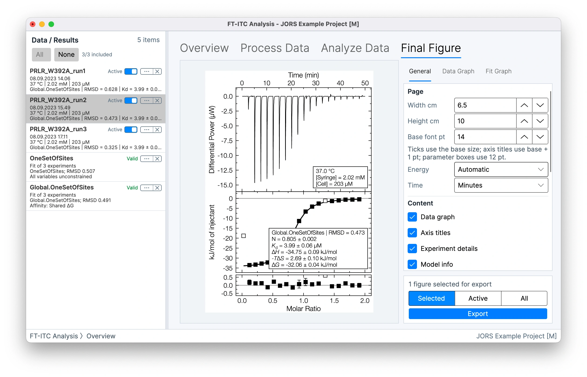
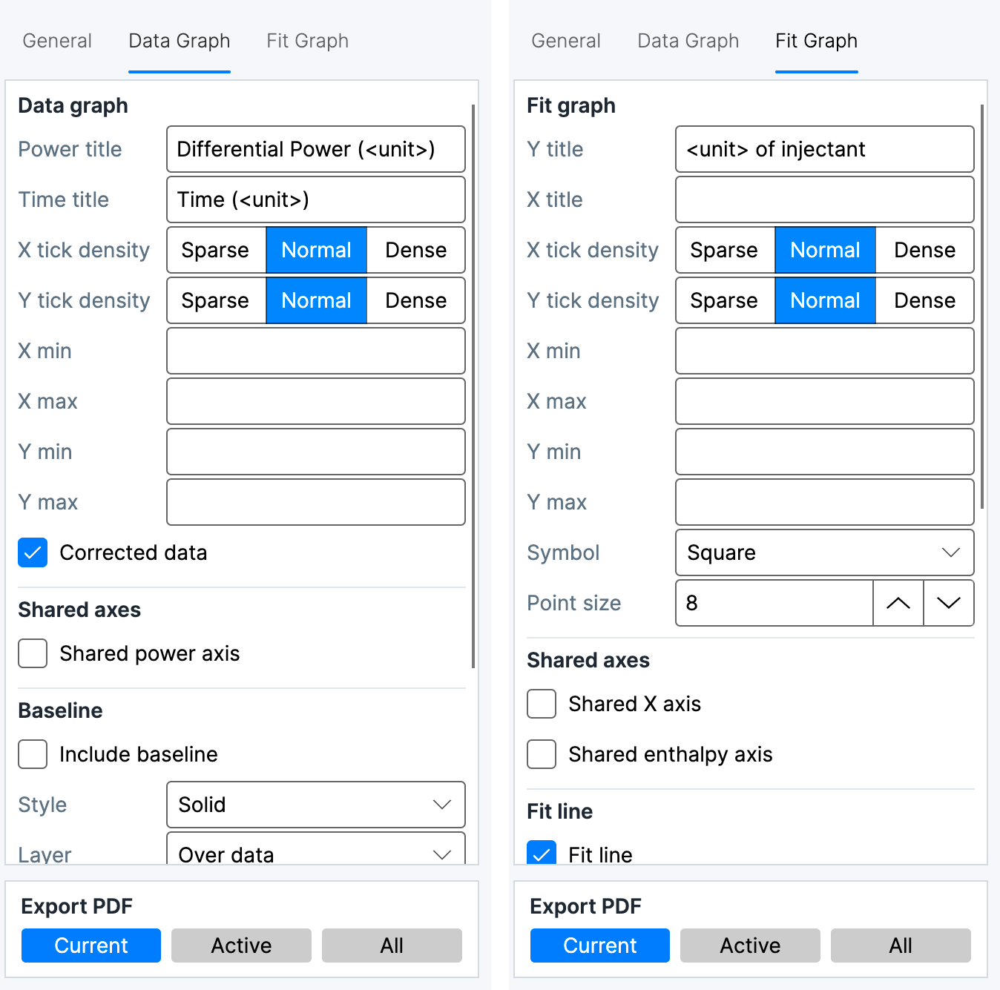
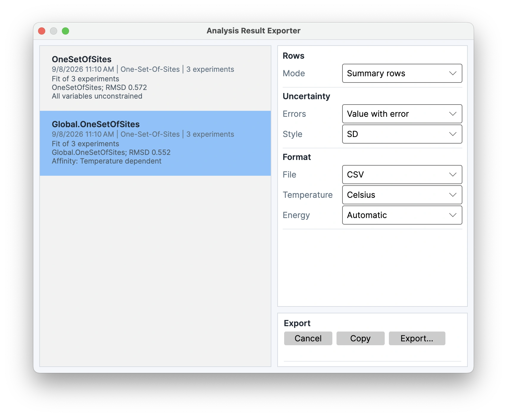
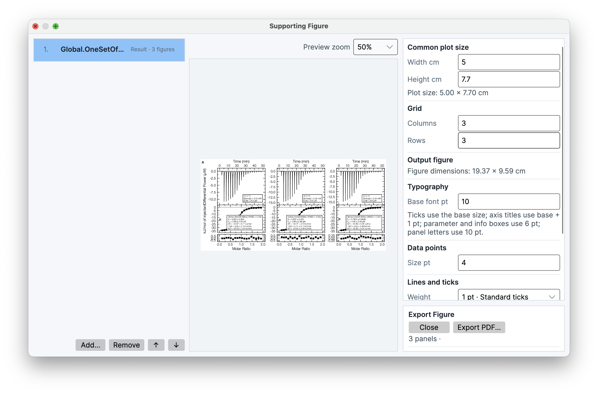

# Figures and export

Choose a figure when you want to show a graph, a data export when you need injection values, and a result table or report when you need to share fitted quantities and their context. Check the selected experiments, units, and uncertainty display before sending an output.

FT-ITC Analysis keeps publication figures, numerical data, and fitted result tables as separate output types. **Final Figure** is an Experiment Data workflow. An Analysis Result does not open directly as a Final Figure; **Export Associated Final Figures...** on a result exports figures for the experiment solutions associated with that result.

## Choose the appropriate output tool

The Analysis Report is distinct from the other output tools:

- **Analysis Result Exporter** writes compact CSV or TSV tables for numerical reuse.
- **Final Figure** writes a publication figure for an experiment, while **Export Associated Final Figures...** writes one figure per result member.
- **Supporting Figure** composes selected figures into one multi-panel canvas.
- **Analysis Report** assembles one or more saved results as self-contained chapters with figures, detailed tables, diagnostics, optional advanced plots, and source and analysis history.

## Final Figure

The **Final Figure** workspace renders the selected Experiment Data as a publication figure. Its preview and PDF output reflect the selected experiment, processing state, fitted solution, and figure options. To export figures using the fits stored in an Analysis Result, use **Export Associated Final Figures...** on that result.

The **Export PDF** controls offer three scopes:

- **Selected** opens a save dialog for the displayed experiment figure and suggests the experiment name as the PDF filename.
- **Active** exports figures for Active Experiment Data. **All** exports figures for all Experiment Data in the project.

For **Active** and **All**, choose a parent folder and the app creates or reuses a subfolder named after the saved project file (without its extension). For an unsaved session, it uses the local export date (`yyyyMMdd`) as the folder name.

The result-list command **Export Associated Final Figures...** writes one final-figure PDF per member experiment using that result's saved fits and the current **Plotted model** choice. Choose a parent folder; the app creates or reuses a subfolder named after the result. It is available for a result with exportable solutions. See [Results and advanced analyses](08-results-advanced-analysis.md) for result validity and stored member-solution behavior.

All figure batches use experiment names for their PDF filenames. When names in the same batch would collide, numeric suffixes such as `Experiment (2).pdf` keep them distinct. If any destination PDFs already exist, the app asks once before replacing them; **Cancel** stops the entire export without writing files. Repeating an export replaces the approved PDFs rather than creating additional suffixed copies.

Final Figure preview, PDF export, and printing use the same selected model. Associated and batch exports also use this choice.

> **Where Final Figure settings are used**
>
> - **Final Figure PDFs**, including Active, All, and **Export Associated Final Figures...**, use the current Final Figure appearance controls.
> - **Supporting Figure...** starts with a snapshot of the appearance controls when its window opens. This includes units, axis limits, visible traces and fits, and excluded-point automatic Y scaling. Its model selection follows the existing assessment policy, independently of **Plotted model**. Its own plot size, grid, typography, panel labels, grouping, and information-box controls take precedence; later Final Figure edits do not update an already open Supporting Figure.
> - **Analysis Report** uses a separate compact figure preset and its own energy and uncertainty selections. Final Figure axis limits and excluded-point automatic Y scaling do not carry over to report figures.

### General

The **General** tab defines the page and common content. Page controls specify plot-area width and height in centimeters and the base font size. **Energy units** selects **Joule** or **Calories** for the current app session, starting from the Preferences energy units. The base or kilo prefix is chosen from the figure's plotted and reported central values; with a shared enthalpy axis, all experiments use one unit. The selected family also controls thermogram units: differential power is **µW** or **µcal/s**, while integrated heat is **µJ** or **µcal**. Time controls set the displayed time unit. Content controls include the data graph, axis titles, experiment details, model information, fit parameters, and the information-box placement. The uncertainty selector provides **Automatic**, **SD**, **CI**, **SD + CI**, and **None**. **Automatic** uses the same per-quantity asymmetry rule described under [Uncertainty and evaluation temperature](08-results-advanced-analysis.md#uncertainty-and-evaluation-temperature).

The parameter controls determine which information appears in the information box: thermodynamic, derived, or offset parameters; temperature; concentrations; injection delay; instrument; and user-defined attributes. The information box is descriptive figure content and does not alter the underlying fit.

### Data Graph

The **Data Graph** tab controls the differential-power trace. Power and time axis titles, tick density, and explicit minimum and maximum values define the axes. **Corrected data** selects the baseline-corrected trace when one is available. **Shared power axis** applies one power-axis range across the active experiments represented by a figure set.

Baseline controls expose the baseline, its **Solid** or **Dashed** style, **Under data** or **Over data** layer, and line width. **Integration ranges** displays the integration intervals as **Bar**, **Fill**, or **Endpoint lines**. These overlays describe processing and do not recalculate integration.

### Fit Graph

The **Fit Graph** tab controls the integrated-heats and model panels. Enthalpy and molar-ratio axis titles, tick density, and explicit ranges define the axes. Symbols are **Square** or **Circle**, with an independent point size. **Shared X axis** and **Shared enthalpy axis** unify the corresponding ranges across active experiments; the residual-axis range follows the shared enthalpy setting when configured for unified residual axes.

**Model** groups the plotted model, line width, smoothness, confidence band, and offset correction. **Plotted model** selects **Binding**, **Null**, or **None**. It starts at Binding and keeps your choice across experiments for the current app session. The curve, residuals, fitted parameters, and automatic units and axes follow that choice. The saved assessment, or **No assessment**, is shown below the control; selecting a model neither changes the assessment nor refits the data. You can display the binding model even when the assessment is **No binding detected**.

Null model figures show the full saved dilution-heat prediction against buffer-corrected observations. Offset correction and confidence bands are disabled while Null is selected; their settings are retained when you return to Binding.

**Auto Y axis includes excluded points** lets excluded injections affect the automatic integrated-heat and residual axis ranges. It starts from the application preference. Explicit axis limits take precedence.

**None** shows processed observations without a model curve, confidence band, residuals, fitted parameters, model information, parameter guides, or fitted offset correction. Inactive controls keep their settings for when you return to a compatible model.

**Line width** sets the model curve thickness. **Smoothness** selects **Smooth**, **Spline**, or **Linear** interpolation. **Show residuals graph** adds the residual panel, and **Residual gap** separates it visually from the fit panel. The display controls include the zero enthalpy line, error bars, excluded points, and excluded error bars. **Confidence band** and **Offset correction** are in **Model**. Error bars use processed injection uncertainties; confidence bands require suitable stored resampling solutions and are unavailable for profile likelihood; fit lines and residuals require a fitted solution.

Traceability Mode keeps excluded injections visible in figures and disables the excluded-point visibility control. This does not include those injections in the fit.

## Numerical data export

**File > Export Data...** opens the numerical export dialog. **Export Selected Data...** invokes the same export for the selected experiment. The data scope is one of **Selected experiment**, **Active experiments**, or **All experiments**.

The format list contains:

- **Thermogram Data** — a `.csv` file containing time and power samples, with the **Export baseline-corrected trace** option when baseline-corrected samples exist.
- **Integrated Peaks** — a `.csv` file containing injection-axis values, molar heats, their SD, fitted values, and residuals when available, with **Export offset-corrected peaks** when a fitted solution is available.
- **Combined Data** — a `.csv` file placing thermogram samples and integrated-peak columns side by side. It includes raw and baseline-corrected traces when available; peaks and fitted values are exported without fitted-offset correction, with residuals when available.
- **MicroCal / SEDPHAT** — a `.dat` file with MicroCal-style `DH`, `INJV`, `Xt`, `Mt`, `XMt`, `NDH`, `DY`, and `Fit` columns. `DH` is in µcal, `INJV` is in µL, concentrations are in mM, and `NDH`, `DY`, and `Fit` are in cal/mol. The first injection uses `--` for normalized heat and residual, following the conventional excluded-first-injection layout.
- **pytc** — a `.dh` file containing the pytc-compatible injection and metadata fields.
- **ITCsim** — a `.csv` file containing ITCsim-compatible injection data and metadata, with offset-corrected peaks available when a fitted solution exists.

**Molar-energy unit** is available for Integrated Peaks, Combined Data, and ITCsim: choose **J/mol**, **kJ/mol**, **cal/mol**, or **kcal/mol**. Each export dialog starts at kJ/mol for the Joules energy preference or kcal/mol for the Calories preference; a choice applies to that export only. Integrated Peaks and Combined Data identify the chosen unit in the heat, SD, model, and residual column headers. ITCsim keeps its `PeakHeat` column name and records the unit as `#EXPINFO ENERGYUNIT J`, `KJ`, `CAL`, or `KCAL`; those tokens denote energy per mole. Peak area is an absolute heat in J and is distinct from the exported molar heat.

Numerical exports use a period as the decimal separator, regardless of regional settings.

Other output units remain format-specific. Thermogram samples use seconds and watts; MicroCal/SEDPHAT and pytc use their documented concentration, volume, temperature, and heat conventions. Fitted columns and correction controls are disabled when the selected data do not contain the corresponding processed or fitted state. Export defaults are described in [Settings and defaults](11-preferences-troubleshooting.md).

These exports are not project backups. General `.csv` and `.tsv` exports cannot be reopened through **File > Open...**. A MicroCal / SEDPHAT `.dat` export or pytc `.dh` export can be reopened as integrated-heat input, but doing so restores neither a thermogram nor the FT-ITC project state and requires choosing the source heat unit. Select **microcalorie** for the `DH` column when reopening a newly generated MicroCal / SEDPHAT export. Historical FT-ITC `.dat` exports may instead require **joule**, matching the unit used when they were created. Save an `.ftxtc` project when the analysis must remain editable.

## Analysis Result Exporter

**Copy Result Table** copies one row per experiment as tab-separated text for pasting into a spreadsheet. Values and uncertainties occupy separate columns, following the uncertainty display preference; **None** copies values only. For combined summary rows or other table formats, use **Analysis Result Exporter...**.

**Analysis Result Exporter...** builds a table from one or more selected Analysis Results. **Summary rows** produces one row per result; **All replicate rows** produces one row per member fit. Error layout is **Value with error** or **Separate columns**. Uncertainty style is **SD**, **CI**, or **SD + CI**. The file format is **CSV** or **TSV**. **Energy units** provides **Automatic**, **J**, **kJ**, **cal**, and **kcal**. Automatic chooses one stable molar-energy unit across all selected results and one independent unit for $\Delta C_{\mathrm{p}}$ columns; a fixed choice uses the selected energy unit consistently. Temperature presentation is **Celsius** or **Kelvin**; changing the unit preserves the physical evaluation temperature. The exporter remembers its unit when reopened during the current application session, independently of Results. Both start from **Preferences > Temperature units**; changing that preference resets both choices.

The configured table is available through **Copy** and **Export...**. Copy places the same delimited text on the clipboard; Export writes it to a file. Numeric values in exported and copied result tables use a decimal point regardless of regional settings. Profile-likelihood SD columns use the equivalent display scale implied by their stored endpoints and are labeled as such in exported metadata; the exact lower/upper endpoints remain available in separate-column mode. The exporter does not include the parameter-correlation matrix, which is calculated for display rather than stored as a result-table field.

Summary rows use the same Parameter Evaluation calculation at its default evaluation temperature: the configured reference temperature for a temperature series, otherwise the mean experiment temperature. The exported temperature column labels that evaluation temperature. Local summary rows report **Combined SD** and an **Approximate propagated interval**, using the same calculation described under [Parameter Evaluation](08-results-advanced-analysis.md). Summary interval columns have neutral `_interval_lower` and `_interval_upper` suffixes; individual rows retain their CI95 columns. $K_{\mathrm{d}}$ is derived from the summarized Gibbs energy rather than averaged directly, and $\Delta C_{\mathrm{p}}$ columns are included for applicable temperature-dependent results. No results are pooled across separate analyses.

Result tables, clipboard output, final-figure metadata, and viewer output create
thermodynamic columns according to the fitted model. A sequential result therefore
exports one $K_{\mathrm{d}}$, $\Delta H$, $\Delta G$, and $-T\Delta S$ value for every active step, including steps 3
and 4 when present. The fixed step
count is included as model information. Exporting preserves the interpretation of these values: macroscopic sequential
constants remain step constants, not microscopic site constants.
Fitted N, $\alpha$ and fixed stoichiometry occupy separate columns; fixed stoichiometry is the value set under [Stoichiometry](06-fitting-models.md#one-set-of-sites).

Each affinity column chooses its concentration unit independently from its own
magnitude. For example, Kd1 may be shown in nM while Kd4 is shown in µM. The
column header and its values always use the same unit; this is display scaling
only and does not change fitted or saved values.

## Project Information

**File > Project Information...** lists and counts the experiments, Analysis Results, and saved reports in the current project, including inactive experiments. Saved reports hold their selections, presentation settings, study context, and approved interpretation text; the project does not embed exported PDFs or duplicate measurements for each report.

Use the experiment rows to compare temperatures, cell and syringe concentrations, and integration progress. Result rows identify the fitted experiments and their saved temperatures, alongside result validity and binding assessment.

Select a saved report to see its Analysis Results, experiment counts, result availability, whether interpretation text is saved, and any subtitle. **Open** restores its settings and interpretation; **Rename** changes its project entry. **Details** shows the full saved metadata and text, and **Copy All** copies its saved user-entered text. **Delete** removes the report after confirmation. Renaming changes both the saved name and the printed report title. Clear the name to use an automatic name based on its result. **Last saved** records the last save that changed the report; opening, previewing, exporting, and saving the project do not change this date. Older reports may have no recorded save date.

Deleting a report keeps experiments, Analysis Results, and exported PDFs. Reports with missing results can still be inspected, copied, and deleted.

## Analysis Report

**Tools > Analysis Report...** creates a complete, printable report from one or more saved Analysis Results. The same tool is available as **Export Analysis Report...** in result-specific menus, where that result is initially selected. Use **Select report contents...** to choose results and optional supporting experiments together. Opening the tool starts a new report draft. Use **Saved Reports…** in the inspector or **Project Information** to open a saved report and restore its selections, settings, study context, and interpretation. Changing the selected results edits the current draft and retains its interpretation text.

The source experiments of tandems in the selected results may also be selected automatically for a new report. Uncheck any you do not want; saved supporting selections are restored when the report reopens. The picker marks each as **Buffer reference**, **Tandem source**, or both. Choose results and supporting experiments together, then select **Apply**.

### Configure the report

The experiment parameter overview focuses on binding model parameters (N or $\alpha$, $K_{\mathrm{d}}$, and $\Delta H$, as applicable), relevant conditions, and RMSD. Full thermodynamic values appear in the detailed parameter tables.

Choose a title, an optional subtitle, energy and temperature units, and an **Uncertainties** style. Reports default to **SD + 95% CI**. The selected style controls uncertainty in fitted-parameter tables and applicable analysis plots; the thermodynamic summary chart shows available saved 95% confidence intervals. Combined spread, approximate propagated intervals, and model-estimated uncertainty keep their separate labels: an approximate combined interval does not have established 95% coverage. Presentation choices are stored when you save the report.

**Traceability Mode** adds a report preparation and sign-off block with the preparer, generation time, and blank preparer-signature and signing-date fields, plus saved **Analysis operator** names, result identifiers, and recorded experiment and sample identifiers. Enter a **Report ID** to identify the report in its signature and report details; the ID is saved with the report and a blank ID appears as **Not recorded**. The report preparer is the current operator when the preview is built; the analysis operator identifies who created or last updated the fit, and can be different. A blank preparer name appears as **Not recorded** while the PDF Author field remains empty. Experiment dates are reported only when they come from the data file or were entered by the user. An experiment that only has a filesystem timestamp shows that date marked **(file system date)**, which does not establish when the experiment was run. If the current operator changed after the preview was built, export automatically rebuilds and refreshes the preview with the current name before writing the PDF. Missing experiment and sample IDs appear as **Not recorded** only in Traceability Mode; otherwise, blank IDs are omitted. Missing IDs do not prevent report creation or export.

Each experiment’s parameter table labels values **Fixed**, **Fitted**, or **Derived** based on the saved solution and global constraints. Fixed estimates retain their values and units but do not show uncertainty decoration.

**Optional content** includes **Injection tables**, **Condense repeated experiments**, **Expanded explanations**, **Parameter correlations**, and completed advanced analyses. Expanded explanations adds contextual notes for approximate summary uncertainty, weighted fit diagnostics, and others.

Condensing repeated experiments replaces repeated acquisition and processing details with a reference to the first occurrence, while retaining each result's figures, fit, and scientific context. The analyses you select are included from their saved results; report creation does not rerun them.

### Save a report

**Save Report** stores the current draft in the project, updating the opened report or creating a new one. **Save Report As…** stores a separate copy and switches to that copy, keeping the original report unchanged. Both include selections, presentation settings, study context, and interpretation. The title supplies the saved name; an automatic or blank title uses a name based on the report contents.

Saving a report marks the project unsaved. Use **File > Save** to write the project to disk. Project save commands, including **Cmd-S** on macOS or **Ctrl-S** elsewhere, save the project without saving edits still in the report draft. Preview and PDF export also use the current draft without saving it. When leaving an edited draft, choose **Save**, **Discard**, or **Cancel**.

### Write and preview an interpretation

The builder provides an editor for your remarks. A formatting hint shows the available Markdown shortcuts: `##` section headings, `###` subsection headings, `-` bullets, `**bold**`, and `*italic*` emphasis. Use **Interpretation / Preview** to switch between writing and the rendered report. **Preview** shows the current report, **Update Preview** refreshes it after edits, and **Export PDF...** saves it. Results with warnings or outdated inputs remain exportable with a prominent notice. A structurally unusable result shows a validation error and cannot be previewed or exported.

Editing an interpretation makes it user-written and current, including when it began as generated text. Its previous AI source details and freshness status are replaced. Text edits remain unsaved until **Save Report** or **Save Report As…**, even if you undo them back to the original wording.

If included results change after the interpretation was written or confirmed, the builder asks you to check that the text is still accurate. This includes changes to values, uncertainties, assessments, names, or comments, and changes to which results are included. Choose **Confirm**, or edit the text, then save the report. The notice applies to both user-written and generated text and returns after a later result change. **Confirm** preserves the text and its source; for generated text it does not change the separate **Current / Out of date / Cannot verify** status or printed freshness warning.

### Report contents and layout

The report is a printable A4 PDF. It starts with a front page that lists the included results and the contents, followed by a chapter for each result. An approved interpretation follows the front page. Results are referenced as **1**, **2**, and so on, and their experiments as **1A**, **1B**, **2A**, **2B**, and so on. Figures and interpretation use these same references. Results remain separate even when they use the same experiment.

The conditions beneath each experiment heading show nominal initial concentrations in syringe ▸ cell order (for example, `100 µM ▸ 10 µM`) and the target temperature. Recorded buffers with pH, salts, competitor concentration, and explicitly entered ionic strength are also included; Experiment details retains available concentration uncertainties and measured temperature.

The analysis summary identifies the model, options, scope, constraints, fixed settings, fit details, and member estimates. Standard and Diagnostic output follow the [binding-assessment policies](08-results-advanced-analysis.md#null-hypothesis-test): no-binding values are suppressed in Standard output, unavailable values use **—**, and combined values are never recomputed from an eligible subset.

Each experiment's **Fit details** include the Wiseman c-value, $c = N M_0 / K_{\mathrm{d}}$, calculated from the initial cell concentration $M_0$ and the fitted $N$ and $K_{\mathrm{d}}$ (an apparent value from the apparent $K_{\mathrm{d}}$ for Competitive Binding, and one value per site class or sequential step); the curve shape usually determines $K_{\mathrm{d}}$ well only for c roughly between 1 and 1000.

**Combined parameters** states its **Evaluation temperature**, using the [default Parameter Evaluation temperature](08-results-advanced-analysis.md#uncertainty-and-evaluation-temperature). This is independent of an edited result-view temperature and the saved fitting reference. Evaluation uses stored relationships without refitting.

The thermodynamic chart includes each eligible result member and active binding step, identifying any omitted no-binding members. Its whiskers show available saved 95% confidence intervals independently of SD availability; SD values remain available in the tables. Fixed parameters have no uncertainty bars. In warning summaries, “N of M experiments” counts affected eligible members against all members of that result; overview fit warnings exclude no-binding members, while Diagnostic appendix warnings retain them. Experiment sections include the thermogram where available, a final figure, any fit warnings for that experiment, fitted and derived parameters, and selected correlations. **Fit details** reports dimensionless c-values where the model defines them. For one- and two-site models, the Wiseman value is $c = N[\mathrm{cell}]_0/K_{\mathrm{d}}$; syringe correction uses the fixed site count. Sequential fits report $[\mathrm{cell}]_0/K_{\mathrm{d}}$ for each active step, while competitive fits use the apparent $K_{\mathrm{d,app}}$. When **Injection tables** is selected, the report includes each injection's inclusion state, volume, concentrations, heat, measurement SD, fitted heat, and residual. Fit and residual columns use the reported member’s saved solution; residual means observed heat minus predicted heat. Supporting-experiment tables show observations only, even if the experiment has an attached fit. An unavailable thermogram is identified in the report.

Each experiment's processing or data-availability details include the injection bookkeeping saved with its fit. When experiments in one result use different bookkeeping methods, the result overview and the report warnings flag it. The analysis summary lists the buffer subtraction saved with each fit; experiment details show the experiment's current buffer subtraction among its attributes. Parameter tables identify fixed estimates and omit uncertainty intervals for them. Processing details, observations, and injection tables describe **Current experiment data**, while fitted parameter values come from the saved result. Supporting experiments have no saved fit settings, so their subtraction details are omitted; correction provenance remains available where relevant.

**Competitor properties** shows source values captured for the reported fit when available. Selecting a source alone does not capture its properties; capture occurs when a fit uses **From attributes** for competitor affinity or enthalpy.

**Baseline method** identifies the current spline interpolation and actual point count, or the polynomial degree or segmented baseline type. Spline density describes the current points, including manual edits and conversions.

When an experiment has no raw thermogram, **Data availability** identifies its input as imported integrated heats. Baseline and integration details appear only for experiments with a thermogram.

Selected experiments not already represented by a result appear once as **Supporting experiments**, labeled **S1**, **S2**, and so on. They contribute existing traces, processing, heats, metadata, dates with their source, attributes, comments, and optional injection tables; their heats are explicitly shown without a fit. Represented experiments cannot be selected again as supporting data. Automatically selected buffer references remain optional, and the report does not judge whether they are appropriate blanks. Creation does not fit, reintegrate, or perform subtraction.

**Source file** identifies each experiment's source filename and format, or marks the format unknown.

A single appendix at the end of the report lists every experiment once, with the labels it is reported under and any role as a buffer reference or tandem source (for example **Tandem source for 1A, 2B**), followed by report warnings and software details.

Source links are recorded when the Experiment Merger creates a tandem. If any of those sources are no longer in the project, a **Tandem sources** item in the tandem's experiment details gives the count. Older tandems and files that already contain concatenated runs have no source links; add their source experiments manually if needed.

### Generate an automated interpretation

Choose **Generate interpretation…**, enter a **Main question** and **Additional context**, and select **Interpretation depth**. Review the selected results and supporting experiments. **Evidence level** controls fitted result detail: **Results**, **Injection data**, **Processing details**, or **Thermograms**. Each level includes the lower levels. Injection data is the default where permitted; Public access uses Results. Standard access permits Injection data, and Advanced or Administrator access also permits Processing details and Thermograms. Thermograms requires a fresh selection each time the dialog opens. Supporting experiments always provide summary information; they do not send injection rows or traces. The inspector identifies user-written or generated text and its freshness.

Review the returned draft, then choose **Use in report** to add it to the report. Edit it in the report builder if needed. Check its scientific claims and references against the underlying results.

**Online generation privacy:** Generate sends selected names, comments, conditions, fits, injection evidence, and your question/context to the FT-ITC service, which uses OpenAI. Thermograms require opt-in. Usage metadata has no automatic expiry; full evidence and generated text are excluded from that metadata. Provider and infrastructure retention are separate, with no guaranteed deletion deadline. Canceling does not retract sent data. Read [Data flow and retention](03-installation-files-projects.md#online-data-flow-and-retention) before sending sensitive material.

#### Evidence and interpretation limits

Generation assesses all selected results and supporting experiments together, using the same references as the PDF. Results remain independent, including alternative fits of the same experiment. Supporting experiments contribute summary metadata without being assigned a fitted result or assumed control role. Processing details and Thermograms add processing settings and baseline summaries; injection rows or traces are not sent for supporting experiments. Generation uses existing processing, integration, residual, and uncertainty evidence where available; it does not rerun integration, baseline fitting, or model fitting. When compressed thermograms are included for fitted result members, they contain minimum and maximum power values for each 15-second interval, plus an aligned fitted baseline when available. Exact peak timing, the order of values within each interval, and the detailed waveform are unavailable. The dialog shows the compact package size against your current request limit and blocks generation when the estimated request is too large. An opted-in thermogram is retained in the request; a size or model-context error is shown instead of silently omitting it.

Generation requests include each tandem's source links; a source experiment's own data are sent only when it is selected for the report.

When generation succeeds, the desktop app sends an **Interpretation ready** system notification. Whether it appears depends on operating-system notification support and permissions. The draft remains available in the generation dialog for review.

Completed structuring, electrostatics, and protonation analyses are included when available for the selected results. Results includes fitted values, uncertainty, assessments and fit/residual summaries. Injection data adds acquisition details and injection-by-injection heat and fit comparisons. Processing details adds integration boundaries, baseline statistics and controls, and historical fit-input snapshots where available. Thermograms adds compressed signal and aligned baseline traces.

If the selection contains outdated or failed analyses, a warning gives you an opportunity to review them before continuing. The report distinguishes saved fit inputs and estimates from current observations; some comparisons are unavailable when the saved fit cannot be matched to the current data. An interpretation can identify potential concerns, but it does not certify the experiment or establish a mechanism. The service may suggest references from details such as a paper title, journal, or year, but it does not search the web.

Markdown tables require a header and separator row. Use a few columns to keep them readable; unsupported formatting may appear as literal text in the report.

The generated draft is read-only in the generation dialog. Choose **Use in report**, then edit it in the report builder if needed. Canceling, closing the dialog, or encountering a service error leaves previously approved text unchanged. Study context, evidence settings, approved text, and generation details are saved with the report. Changes to selected results, supporting evidence, context, or settings can mark an untouched generated interpretation as out of date. In Traceability Mode, user-written interpretations show their user source and writing time; untouched generated interpretations show their generation details.

### Save a local copy of interpretation evidence

Use **Save package** in the generation dialog to save a local ZIP of the evidence, question, context, and settings selected for that request. Saving the ZIP does not contact the interpretation service or run new fits. The archive contains the full local evidence, including supported injection data and compressed thermograms, together with the exact compact payload prepared at the selected evidence level. The level limits what is sent to the service; the local archive can contain more data. Review it before sharing.

### Troubleshoot automated interpretation

If generation fails, note the visible error and use **Copy Support Report** when contacting support. Local report editing and PDF export remain available if online generation is unavailable.

## Supporting Figure

**Supporting Figure...** composes figures from Experiment Data and Analysis Results into a multi-panel canvas. The **Figure order** list defines source order; **Add…**, **Remove**, **Up**, and **Down** change the composition. Closing and reopening the tool retains the selected sources, their order, plot size, grid, typography, display settings, and preview zoom for the current document during this app session. The source picker can filter available experiment and result figures by name or type.

Set the plot size, grid columns and rows, font size, point size, line weight, and tick style for the composed figure. Extra panels continue on additional PDF pages. **Light** and **Standard** provide different line and tick weights. **Panel letters** labels panels A, B, and so on; **Panel titles** can add experiment names. **Group result figures** and the information-box controls adjust how results are presented. Review the preview, then choose **Export PDF...**.

## Printing

**File > Print** prints the active graph or figure through the operating system’s print workflow. The active target can be the overview thermogram, processing graph, analysis graph, result graph—including an available **Correlation** matrix—or Final Figure, depending on the selected workspace. The operating-system print dialog supplies the available printer and PDF destinations; the graph content comes from the active application view.
