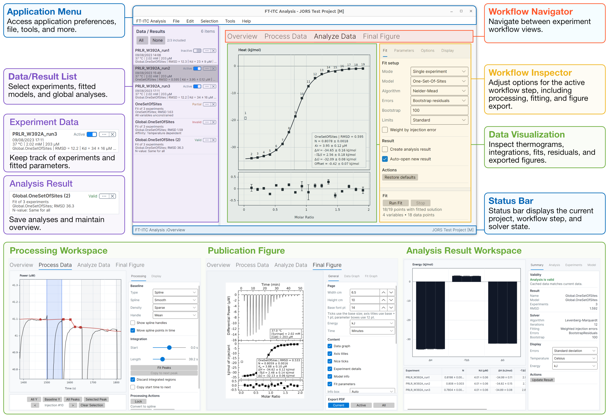

# FT-ITC Analysis

[](https://github.com/FrederikTheisen/FT-ITC-Analysis/releases/latest)
[](https://github.com/FrederikTheisen/FT-ITC-Analysis/releases)
[](https://doi.org/10.5281/zenodo.14832177)
[](https://ft-itc.org)
[](https://app.ft-itc.org)

[Website](https://ft-itc.org) ·
[Manual](https://ft-itc.org/manual) ·
[Quick start](https://ft-itc.org/manual/quick-start) ·
[Latest release](https://github.com/FrederikTheisen/FT-ITC-Analysis/releases/latest) ·
[Software DOI](https://doi.org/10.5281/zenodo.14832177) ·
[License](LICENSE.md)

FT-ITC Analysis is an open-source desktop application for processing,
analyzing, and presenting isothermal titration calorimetry (ITC) data. It
supports baseline correction, peak integration, model fitting,
multi-experiment analysis, uncertainty estimation, and publication-oriented
figures, reports, and data export.

> **Version 1.5 is coming soon.** This README describes the upcoming release;
> some features listed below are not available in the current public version.
> See the [latest public release notes](https://github.com/FrederikTheisen/FT-ITC-Analysis/releases/latest)
> for what is currently available.

[](Documentation/assets/program-overview.png)

## Getting started

Install the application, then follow the [quick start](https://ft-itc.org/manual/quick-start)
to open data, process a thermogram, fit a model, and save a portable `.ftxtc`
project. The [manual](https://ft-itc.org/manual) explains the controls and
scientific assumptions. Workflow help is also available in the application.

## Install

### macOS

For Intel and Apple silicon Macs; see the release notes for system requirements.

1. Download the macOS DMG from the [latest release](https://github.com/FrederikTheisen/FT-ITC-Analysis/releases/latest).
2. Open it and drag **FT-ITC.app** to **Applications**.
3. Launch **FT-ITC** from Applications.

The macOS application is signed and notarized.

### Linux

1. On a compatible Debian-based distribution, download the `.deb` for your
   architecture (AMD64 or ARM64, when available) from
   the [latest release](https://github.com/FrederikTheisen/FT-ITC-Analysis/releases/latest).
2. Install it with `sudo apt install ./PACKAGE.deb`, replacing `PACKAGE.deb`
   with the downloaded filename.
3. Launch **FT-ITC Analysis** from the application menu.

### Windows

1. Download the x64 setup executable from the
   [latest release](https://github.com/FrederikTheisen/FT-ITC-Analysis/releases/latest).
2. Run the installer; administrator access is not required.
3. Launch **FT-ITC Analysis** from the Start menu.

The Windows installer supports x64 Windows 10 and Windows 11. It is currently
unsigned, so Windows may show **Unknown publisher** or a Microsoft Defender
SmartScreen warning. Only continue when the installer was downloaded from this
repository.

### Updates and removal

Install a newer package over the existing application to update it. Removing
the application does not delete projects, exported data, settings, or
autosaves. Report installation problems through the
[GitHub issue tracker](https://github.com/FrederikTheisen/FT-ITC-Analysis/issues).

## Supported files

- MicroCal-style raw data: `.itc`
- TA Instruments NanoITC native data: `.nitc`
- TA Instruments / NanoAnalyze exports: `.TA`
- PEAQ-ITC projects: `.apj` (every experiment; raw data only)
- Legacy Origin ITC projects: `.opj` (first compatible worksheet)
- Integrated heats: `.dat`, `.aff`, `.dh`
- FT-ITC Analysis projects: `.ftxtc` (current), `.ftitc` (legacy import)

Input data are read but not modified. Save work as `.ftxtc` to preserve data,
processing settings, fit results, analysis results, and comments.

## Main capabilities

- Spline, polynomial, and segmented baseline correction
- Global or per-injection integration-region editing
- One-set-of-sites, two-sets-of-sites, sequential binding-sites (2–4 steps),
  competitive, and dissociation models
- Multi-experiment/global analysis with shared, free, fixed, or
  temperature-dependent parameters
- Residual-bootstrap uncertainty estimates and profile-likelihood intervals
- Leave-one-out sensitivity checks
- Temperature-, salt-, and buffer-dependent analyses
- Tandem-experiment merging and buffer subtraction
- Final Figures, multi-panel Supporting Figures, PDF analysis reports, and
  numerical data export

The [web viewer](https://app.ft-itc.org) displays saved projects in a browser.
Optional automated interpretation is available when preparing an analysis report.

For validation methods, reference data, reproduction steps, and limits, see the
[scientific evidence matrix](AnalysisITC.Tests/ScientificValidation/README.md).

## Privacy

Desktop processing, fitting, saving, recovery, printing, and export run locally.
Optional release and citation checks can be disabled in preferences.

- **Web viewer:** opening a project uploads the entire file, including embedded
  data and comments, to **app.ft-itc.org** for display.
- **Automated interpretation:** choosing **Generate** sends selected scientific
  evidence, your question, and context through **app.ft-itc.org** to at third-party model provider. Evidence can include names, comments, fits, and injection data;
  compressed thermograms are off by default. Opening the dialog can check
  availability and access without sending scientific evidence.

Interpretation usage metadata are retained without automatic expiry, but do not
contain full scientific payloads or generated prose. Viewer temporary-file cleanup
is best effort; no end-to-end deletion deadline is guaranteed. See the
[data-flow and retention description](Documentation/UserManual/pages/03-installation-files-projects.md#privacy-and-online-checks)
and [service privacy notice](AnalysisITC.Web/wwwroot/privacy.html).

## Development and tests

The active native macOS (Xamarin.Mac) and cross-platform (Avalonia) clients share
`AnalysisITC.Core` with the web viewer. Install the .NET SDK selected by
[global.json](global.json). From the repository root, build and launch Avalonia with:

```bash
dotnet run --project AnalysisITC.Avalonia/AnalysisITC.Avalonia.csproj
```

Run the automated suites with:

```bash
dotnet test AnalysisITC.Core.Tests/AnalysisITC.Core.Tests.csproj --configuration Release
dotnet test AnalysisITC.Avalonia.Tests/AnalysisITC.Avalonia.Tests.csproj --configuration Release
dotnet test AnalysisITC.Web.Tests/AnalysisITC.Web.Tests.csproj --configuration Release
```

Native macOS development also requires Mono, Xamarin.Mac, and Xcode command-line
tools. Run its managed UI and rendering checks with
[`AnalysisITC.MacOS.Tests/run-analysis-null-graph-tests.sh`](AnalysisITC.MacOS.Tests/run-analysis-null-graph-tests.sh).

See the [native macOS packaging guide](AnalysisITC.MacOS/Packaging/README.md) and
[Avalonia packaging guide](AnalysisITC.Avalonia/Packaging/README.md) for release
procedures. Web service settings are in
[appsettings.json](AnalysisITC.Web/appsettings.json); deployment is covered in the
[MIST deployment notes](Documentation/Interpretation/MIST_DEPLOYMENT.md).

## Citation and license

Use [CITATION.cff](CITATION.cff) for the version-specific software citation;
**Help > Citation** also provides citation information. The all-versions software
DOI is [10.5281/zenodo.14832177](https://doi.org/10.5281/zenodo.14832177).
The software paper citation will be added when published.

FT-ITC Analysis is distributed under the MIT License. Third-party notices are
included in [LICENSE.md](LICENSE.md).
